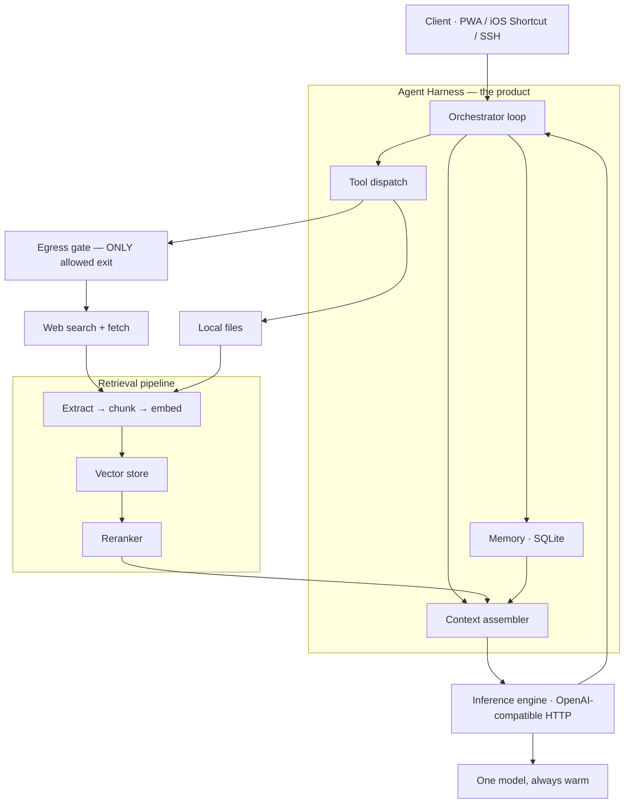
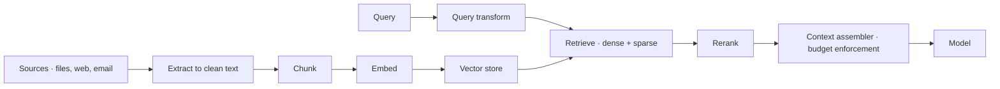

# Private Local AI Stack — Research & Technique Catalog

A working index of everything under consideration for a fully-private, always-on personal AI service running on an M4 Mac mini. This is a **documentation dump, not a plan** — design decisions come later. The goal here is to have every technique, tool, and paper in one place with an honest note on what it costs and whether it survives contact with the hardware.

**Last updated:** 2026-09-01

---

## 0. The Box (hard constraints everything is measured against)

| Property | Value | Consequence |
|---|---|---|
| Machine | Mac mini, base M4 | Active cooling — sustains load indefinitely, unlike a MacBook Air |
| Unified memory | 16 GB, **not upgradeable** | Permanent ceiling. Upgrade path is a second machine, not a stick of RAM |
| Memory bandwidth | ~120 GB/s | Sets the hard decode ceiling: `max tok/s ≈ bandwidth ÷ model size in GB` |
| GPU | 10-core, Metal | Barely matters — decode is bandwidth-bound, not compute-bound |
| Neural Engine | 16-core, ~38 TOPS | Useless for LLM decode. **Ideal for speech.** Free silicon if used |
| Storage | Internal SSD, very fast | Makes disk-tiered KV cache and expert offload plausible |
| Egress policy | **Local models + web search only** | No frontier API. No inference leaves the box, ever |

### Working RAM budget

| Consumer | Estimate |
|---|---|
| macOS floor | 3–4 GB |
| Harness process, SQLite, Python | ~1 GB |
| Speech process (when active) | ~0.5–1 GB |
| Vector store | 0.2–1 GB depending on choice |
| **Remaining for weights + KV cache** | **~9–10 GB** |

Practical read: **~7–8 GB of weights maximum** if you want usable context. One model, always warm. No swapping between models — there is no room for two.

### The governing equation

```
max tokens/sec  ≈  memory bandwidth (GB/s)  ÷  model size in memory (GB)
```

Real results land at 60–80% of this. Everything in this document is either (a) shrinking the numerator's workload, (b) shrinking the denominator, or (c) getting more useful output per token generated. Categorize any new idea you find by which of those three it does — if it does none, it will not help.

---

## 1. Master Taxonomy

```mermaid
graph LR
  ROOT["Private Local AI Stack"]

  ROOT --> INF["1 · Inference"]
  ROOT --> CTX["2 · Context & Retrieval"]
  ROOT --> AGT["3 · Agency & Tools"]
  ROOT --> TRN["4 · Training & Adaptation"]
  ROOT --> SYS["5 · System & Ops"]
  ROOT --> MSR["6 · Measurement"]
  ROOT --> OBS["7 · Infra & Observability"]
  ROOT --> UI["8 · Interface"]

  INF --> I1["Engines / Runtimes"]
  INF --> I2["Weight Quantization"]
  INF --> I3["KV Cache"]
  INF --> I4["Decode Acceleration"]
  INF --> I5["Memory & Offload"]
  INF --> I6["Kernel Level"]
  INF --> I7["Test-Time Compute"]

  I1 --> I1a["llama.cpp + Metal"]
  I1 --> I1b["MLX / mlx-lm"]
  I1 --> I1c["Ollama"]
  I1 --> I1d["Native Metal runtimes"]

  I2 --> I2a["GGUF K-quants"]
  I2 --> I2b["Unsloth Dynamic UD"]
  I2 --> I2c["GPTQ / AWQ"]
  I2 --> I2d["Rotation: QuaRot / SpinQuant"]
  I2 --> I2e["Codebook: QuIP# / AQLM"]
  I2 --> I2f["QAT"]
  I2 --> I2g["Ternary 1.58-bit"]

  I3 --> I3a["KIVI asymmetric 2-bit"]
  I3 --> I3b["QJL / TurboQuant"]
  I3 --> I3c["Eviction: H2O / StreamingLLM"]
  I3 --> I3d["Runtime cache-type flags"]

  I4 --> I4a["MTP"]
  I4 --> I4b["EAGLE-3"]
  I4 --> I4c["Draft-model spec decode"]
  I4 --> I4d["Prefix caching"]

  I5 --> I5a["mmap / page cache"]
  I5 --> I5b["MoE expert offload"]
  I5 --> I5c["Disk-tiered KV"]
  I5 --> I5d["iogpu.wired_limit_mb"]

  I6 --> I6a["Metal Shading Language"]
  I6 --> I6b["MPP TensorOps"]
  I6 --> I6c["mx.fast.metal_kernel"]

  I7 --> I7a["Self-consistency"]
  I7 --> I7b["Best-of-N + verifier"]
  I7 --> I7c["Reflection / critique"]

  CTX --> C1["Ingest & Extract"]
  CTX --> C2["Chunking"]
  CTX --> C3["Embeddings"]
  CTX --> C4["Vector Store"]
  CTX --> C5["Retrieval Strategy"]
  CTX --> C6["Reranking"]
  CTX --> C7["Context Assembly"]

  C4 --> C4a["Qdrant"]
  C4 --> C4b["sqlite-vec"]
  C4 --> C4c["LanceDB"]
  C4 --> C4d["FAISS"]

  C5 --> C5a["Dense / BM25 / Hybrid"]
  C5 --> C5b["HyDE"]
  C5 --> C5c["Query decomposition"]
  C5 --> C5d["GraphRAG"]

  C7 --> C7a["Prompt compression"]
  C7 --> C7b["Rolling summarization"]

  AGT --> A1["Tool calling"]
  AGT --> A2["Web search"]
  AGT --> A3["Browser control"]
  AGT --> A4["Local files"]
  AGT --> A5["Memory store"]

  A3 --> A3a["browser-use"]
  A2 --> A2a["SearXNG self-hosted"]

  TRN --> T1["PEFT: LoRA / QLoRA / DoRA"]
  TRN --> T2["TRL: SFT / DPO / GRPO"]
  TRN --> T3["Unsloth"]
  TRN --> T4["Distillation"]
  TRN --> T5["Ternary QAT — Bonsai-style"]
  TRN --> T6["RAFT"]
  TRN --> T7["Merging / Pruning"]

  SYS --> S1["Tailscale"]
  SYS --> S2["launchd daemons"]
  SYS --> S3["Storage & backup"]
  SYS --> S4["Speech on ANE"]
  SYS --> S5["Interfaces: PWA / Shortcuts"]

  MSR --> M1["Roofline analysis"]
  MSR --> M2["Task eval set"]
  MSR --> M3["KL divergence over PPL"]
  MSR --> M4["CoV / thermal discipline"]

  OBS --> O1["Metrics · Prometheus"]
  OBS --> O2["Tracing · OpenTelemetry"]
  OBS --> O3["Dashboards · Grafana"]
  OBS --> O4["Load & chaos testing"]
  OBS --> O5["SLOs"]
  OBS --> O6["Orchestration · k8s off-box"]
  OBS --> O7["Multi-Mac distributed"]

  O7 --> O7a["mlx.distributed"]
  O7 --> O7b["exo"]
  O7 --> O7c["Thunderbolt interconnect"]

  UI --> U1["Concept · Instrument"]
  UI --> U2["Trace strip"]
  UI --> U3["Context gauge"]
  UI --> U4["Egress ledger"]
  UI --> U5["Provenance gutter"]
  UI --> U6["PWA + iOS Shortcuts"]
```



**Status legend used throughout:** ✅ decided · 🎯 strong candidate · 🧪 experiment · 📚 reference only · ⛔ ruled out for this box

---

## 2. Core Components

The four things that determine whether this project works. Everything else in this document is a modifier on one of them.



### 2.1 Core inference engine ✅

**One runtime in production, exposing an OpenAI-compatible HTTP endpoint.** Not because that API is good, but because every client, eval tool, and future runtime speaks it — swapping the engine becomes a URL change.

Leading candidate: **llama.cpp with Metal**. Reasons: richest quantization ecosystem (imatrix, Unsloth dynamic quants, I-quants), MTP support, KV cache quantization flags, mature and stable as a long-running daemon. `mlx-lm` becomes the **lab** environment, not the server.

The rule that matters more than the choice: **the model is a commodity behind an interface; the harness is the moat.** Expect to swap models three times in the first year. Design so that costs one config line.

### 2.2 Core retrieval system 🎯

With no frontier-model escape hatch, answer quality is **entirely** a function of what lands in the context window. On an 8B at 16 GB you have maybe 16–32K usable tokens. That makes context the scarcest resource in the system and retrieval the highest-value engineering in the project. Full breakdown in §5.

### 2.3 Core agent harness ✅

Separate OS process from the inference engine, so the model server can crash, restart, or be swapped mid-conversation without losing state. Owns: the conversation loop, tool dispatch, persistent memory, and the egress gate.

### 2.4 Core research methodology ✅

How claims get tested, so the catalog below turns into knowledge rather than folklore:

1. **Roofline first.** Before optimizing, determine whether the thing is bandwidth-bound or compute-bound. Decode is bandwidth-bound; prefill is compute-bound. An optimization aimed at the wrong one does nothing.
2. **Express results as % of achievable bandwidth**, not raw tok/s. That's the only number that tells you how much room is left.
3. **Verify the ceiling empirically.** STREAM-style Metal kernel for bandwidth; peak matmul for FLOPS. Use `min(published, measured)`.
4. **Quality-first eval, always.** ~30 real tasks you actually care about, graded by hand once. This outranks every throughput benchmark, because with no escape hatch a fast wrong answer has nothing checking it.
5. **KL divergence over perplexity** for quantization quality. Perplexity hides answer flips — errors cancel at the aggregate level. Keep calibration and evaluation data in disjoint domains.
6. **One variable per experiment.** Log config as JSON alongside every result.
7. **CoV > 5% means the measurement is untrustworthy** — investigate before believing it. Concurrent GPU load has been measured to produce CoV ~84%. If anything else is using the GPU, the benchmark is garbage.
8. **Correctness gate before performance gate.** Temperature 0, fixed seed, compare against a stored reference before timing anything.

### 2.5 The unfair advantage: free tokens 🎯

The one axis where a local box genuinely beats a frontier subscription: **your marginal token costs nothing.** Frontier users pay per token and are latency-sensitive. You are neither. That makes test-time compute — self-consistency, best-of-N with a verifier pass, draft-then-critique, tool-use retries — economically free for you and expensive for them.

This is the single most underrated lever in the whole document, and it buys *intelligence*, not speed. A 8B model given five attempts and a verifier can beat an 8B model given one. Budget for it deliberately.

---

## 3. Inference — Engines & Runtimes

| Tool | Status | Notes |
|---|---|---|
| **llama.cpp + Metal** | ✅ prod candidate | Richest quant ecosystem, MTP, KV quant flags, stable daemon. **Ships a Prometheus `/metrics` endpoint (`--metrics`) plus `/slots` and `/props`** — see §9.3. Originally CPU-first with Metal added later — architecture reflects that |
| **MLX / mlx-lm** | 🎯 lab | Purpose-built for Apple Silicon, but a *general-purpose array framework* — lazy eval and framework scheduling add overhead a dedicated runtime doesn't have. Best path for custom kernels and local LoRA. **No metrics exporter — you instrument it yourself** |
| **Ollama** | ⛔ | llama.cpp plus a convenience layer plus overhead. Fine for trying things, not for a tuned box |
| **vllm-mlx** | 📚 | Continuous batching + prefix caching on MLX. Its wins are throughput-across-requests — you have one stream |
| **vLLM / SGLang / TensorRT-LLM** | ⛔ | CUDA-first. Core innovations (PagedAttention, continuous batching) optimize multi-request throughput. Irrelevant to single-stream |
| **Native Metal runtimes** (BaseRT, uzu, MetalRT) | 🧪 | Bypass MLX entirely; report 1.5–2.2× over framework-based runtimes. uzu routes across GPU kernels and MPSGraph to reach GPU *and* ANE |
| **oMLX** | 📚 | Mac serving layer: continuous batching, block-based prefix sharing, copy-on-write cache blocks, hot-RAM/cold-SSD KV tiers. The tiering idea is worth stealing even if the runtime isn't |

**Honest summary:** MLX vs llama.cpp swings by model and quantization; neither reliably wins. Anyone giving a confident universal answer is guessing. This is a harness question.

---

## 4. Inference — Optimization Techniques

### 4.1 Weight quantization

The single highest-leverage knob, because it's a **near-linear speedup**, not just a memory saving — 4× less data moved per token is ~4× the throughput.

| Family | Method | Status | Notes |
|---|---|---|---|
| Block / mixed-precision | **GGUF K-quants** (Q4_K_M, Q5_K_M) | ✅ | Most blocks 4-bit, selected attention/embedding layers higher. Why they beat naive INT4 at the same average bit width |
| Block / mixed-precision | **Unsloth Dynamic 2.0** (UD-Q4_K_XL) | 🎯 | Model-specific per-tensor schemes; layers quantized in one model family differ from another. Reports lower KL divergence than both standard imatrix and QAT quants. Generally the better pick at the same nominal bit width |
| Calibration | **imatrix** | 🎯 | Importance-matrix calibration; lowers KLD and PPL especially at low bit widths. Costs 5–10% inference speed |
| Compression | **I-quants** (IQ3_XXS, IQ2_S) | 🧪 | More efficient per bit, also 5–10% slower to run. A real trade, not a free lunch |
| Salience | **AWQ** | 📚 | Activation-aware channel scaling. Strong at 4-bit, **collapses at 2-bit** — do not push it there |
| Compensation | **GPTQ** | 📚 | Hessian-informed sequential quantization. Better at higher bit widths; more robust than AWQ at low ones |
| Rotation | **QuaRot** | 📚 | Fusible Hadamard rotations destroy outliers while provably preserving FP output. ~8% latency overhead |
| Rotation | **SpinQuant** | 📚 | *Learns* the rotation via Riemannian gradient descent. Beats random Hadamard; the choice of random rotation alone can swing downstream reasoning by ~13 points |
| Codebook | **QuIP# / AQLM** | 📚 | Store bits that *index* a table of high-precision vectors. QuIP more suitable than GPTQ at 2-bit |
| Training-time | **QAT** | 🎯 | Now shipping in consumer models. Gemma 3 QAT Q4_0 12B ≈ full bf16 on MMLU. **Higher bit width is not always better for QAT models** — some ship a single recommended GGUF because higher precisions degraded accuracy |
| Extreme | **Ternary / 1.58-bit** | 🧪 | See §7 — the one path to a 27B-class model on 16 GB |

**Ruled out by measurement, not taste:** MXFP4 — worse on several tensor types than Q4_K, which uses 4.5 bits/weight vs MXFP4's 4.25. Barely more space for materially better quality.

**Tensors that should not be aggressively quantized:** `ssm_out` (Mamba layers), `ffn_down_exps`.

### 4.2 KV cache

Weights are a fixed cost. **KV cache is the variable cost, and on 16 GB it is the binding constraint on context far more often than weights are.**

| Approach | Method | Status | Notes |
|---|---|---|---|
| Quantization | **KIVI** | 📚 | The foundational result: keys have large-magnitude outlier *channels*, values don't. So per-channel for K, per-token for V. Tuning-free asymmetric 2-bit. Most-reused finding in the subfield |
| Quantization | **KVQuant** | 📚 | Offline calibration of quantization params; targets 10M-token context |
| Quantization | **QJL** | 📚 | Johnson–Lindenstrauss transform + sign-bit quantization. Eliminates storing scale/zero-point metadata entirely while staying an unbiased estimator of query-key inner products |
| Quantization | **TurboQuant** | 📚 | Extends QJL with online vector quantization — MSE-oriented quantizer plus QJL residual correction. Reports quality-neutral at 3.5 bits/dim, marginal degradation at 2.5. **Research-stage; no mainstream runtime support yet** |
| Quantization | **GEAR** | 📚 | Low-rank + sparse matrices fitting the residual error on top of standard quantization |
| Quantization | **KVTuner** | 📚 | Sensitivity-aware layer-wise mixed precision — different layers get different bit budgets |
| Quantization | **Runtime flags** (`--cache-type-k/v q8_0`) | ✅ | The practical version available today. Q8 roughly **doubles** achievable context at fixed memory. Q4 next to test |
| Eviction | **StreamingLLM** | 📚 | Keeps initial "attention sink" tokens + sliding window |
| Eviction | **H2O** | 📚 | Recent tokens + "heavy hitters" by attention contribution |
| Eviction | **PyramidKV** | 📚 | Non-uniform budgets across layers, more in lower layers |
| Architectural | **GQA / MLA** | 🎯 | Not a knob — a model-selection criterion. Choose models with GQA |

**Eviction caveat:** irreversible information loss. It may discard exactly what long-range reasoning needed. Quantization is the safer default; eviction is a last resort.

**Rule of thumb:** at 40–50K tokens expect ~10× slower generation than short context. Pick your context target first, compute the KV cost, and let *that* determine max model size — not the other way round.

### 4.3 Decode acceleration

| Technique | Status | Notes |
|---|---|---|
| **MTP** (multi-token prediction) | 🎯 highest priority | Model trained with auxiliary heads predicting multiple future tokens; heads act as a native built-in draft model. Reported 1.4–2.2×, bit-identical output, one flag. **Two prerequisites:** model must be trained with MTP heads, AND the GGUF must have been exported with them preserved — many community quants strip them. Check GGUF metadata for `{arch}.nextn_predict_layers` |
| **Prefix caching** | 🎯 highest priority | Your system prompt is identical every turn. Reported up to **5.8× on TTFT**. ⚠️ Reuse reported broken in mlx-lm for sliding-window / hybrid / Mamba architectures — silently falls back to full recomputation. **Test empirically:** send the same system prompt three times, watch whether TTFT collapses on runs 2 and 3 |
| **EAGLE-3** | 🧪 | Lightweight autoregressive head reading the target's internal hidden states. Acceptance 0.80–0.88 on instruction-following. **Measured only ~1.05× on Apple Silicon** in an mlx-lm prototype — overhead budget is razor-thin when baseline tokens are already ~8.8 ms |
| **Draft-model spec decode** | 🧪 | Separate small model, typically 40–60% acceptance. Setup cost rarely worth it below 70B. **If acceptance drops below 50% it makes you slower** |
| **Tree attention** | ⛔ for now | Blocked in MLX — KVCache uses a single offset integer for RoPE positions, so tree candidates at different depths can't get distinct position IDs. This is where the real speculative gains live |

Two Apple-specific findings worth remembering: speculative decoding has a **model-size sweet spot** — small fast quantized models leave no room for draft overhead to pay for itself. And **quantizing the draft head is free**: 4-bit EAGLE head gave identical acceptance at half the draft forward-pass cost.

Theory to keep in mind: expected acceptance rate ≈ 1 − KL divergence between draft and target distributions. Spec decoding is **lossless** — every draft token is verified before emission.

### 4.4 Memory & offloading

| Technique | Status | Notes |
|---|---|---|
| **CPU/GPU layer offload** (`-ngl`) | ⛔ mostly moot | Unified memory means CPU and GPU share one pool. There is no PCIe transfer to avoid. This knob matters enormously on discrete GPUs and almost not at all here |
| **mmap / page cache** | ⚠️ | The OS pages weights in and out. On 16 GB with a too-large model this *feels* like offloading but is really thrashing. Watch for swap, not just RAM pressure |
| **MoE expert offload** | 🧪 | Keep hot experts resident, cold experts on SSD. Genuinely interesting given the mini's fast SSD — potentially the only way to touch a large MoE on 16 GB |
| **Disk-tiered KV cache** | 🧪 | Hot-RAM / cold-SSD tiers (oMLX-style); LM Studio's mlx-engine does disk-backed KV checkpointing at 256-token boundaries |
| **`iogpu.wired_limit_mb`** | 🧪 careful | sysctl raising how much RAM the GPU may wire down. On 16 GB you are stealing from the OS. Diet the background services first, raise modestly, watch for swapping. One of the few levers that buys either a bigger model or more context |
| **Prompt compression** (LLMLingua) | 🧪 | Compress the prompt itself. Directly attacks the scarcest resource. Underexplored for this use case |

### 4.5 Kernel level

| Item | Notes |
|---|---|
| **Metal Shading Language** | Apple GPUs execute in **32-wide SIMD groups** — think in multiples of 32 |
| **Metal Performance Primitives / TensorOps** | Apple's explicit on-ramp (WWDC26 session 330), aimed at people writing custom ops or contributing to MLX/llama.cpp. Auto-uses hardware acceleration across GPU generations. Core technique taught is tiling |
| **`mx.fast.metal_kernel()`** | MLX's Python prototyping path. ⚠️ Multiple dispatches within a single `eval_gpu()` execute **without guaranteed ordering** — constrains any split-K design |
| **MLX attention kernels** | Already do FlashAttention-style tiling, O(n²) → O(n) memory in sequence length. You will not beat this casually |

**Honest bar:** the best-known hobbyist MLX kernel lab states plainly it does *not* currently claim to outperform MLX native kernels. Research runtimes doing it seriously report 1.5–2.2×.

**Legitimate reasons to write a kernel:** a novel attention variant no library implements, or **custom dequantization logic that needs to run at memory-bandwidth speed**. The second one is squarely relevant here.

**Realistic first project:** naive quantized matvec → measure → compute % of the 120 GB/s ceiling achieved → iterate on coalescing, tiling, SIMD-group ops, fused dequant. Target within ~15% of hardware memcpy speed.

### 4.6 Test-time compute — buying intelligence, not speed

| Technique | Notes |
|---|---|
| **Self-consistency** | Sample N times at temperature, majority-vote the answer. Costs N× tokens, which are free |
| **Best-of-N + verifier** | Generate N candidates, score with a second pass or a small reward model, keep the best |
| **Reflection / critique loops** | Draft → critique → revise. Especially effective at recovering small-model formatting and reasoning slips |
| **Tool-use retries** | On malformed tool calls, re-prompt with the parse error rather than failing |
| **Speculative cascades** | Cheap path first, escalate to the expensive path only on low confidence |

---

## 5. Context & Retrieval

**This is the core of the system**, given no frontier fallback. Broken into the pipeline stages, because "RAG" as a single word hides all the engineering.

### 5.1 The pipeline



### 5.2 Stage-by-stage options

| Stage | Options | Notes |
|---|---|---|
| **Extract** | trafilatura, readability, unstructured, PyMuPDF, Docling | ⭐ **Highest-value unglamorous component.** Raw HTML nav bars will eat your entire context budget. This matters more than the search step itself |
| **Chunk** | Fixed-size + overlap, recursive character, semantic chunking, sentence-window, parent-document | Parent-document retrieval (embed small, return large) is a strong default under tight context budgets |
| **Embed** | BGE-M3, E5, Nomic Embed, gte, Jina, Qwen embeddings | Run locally on ANE/CPU. Multilingual and long-context variants matter if your corpus is messy |
| **Vector store** | See table below | |
| **Retrieve** | Dense, BM25/sparse, **hybrid + RRF**, ColBERT late interaction | Hybrid with reciprocal rank fusion is the reliable default. Pure dense retrieval loses on exact identifiers, names, error codes |
| **Query transform** | HyDE, multi-query expansion, query decomposition, step-back prompting | HyDE (generate a hypothetical answer, embed *that*) is cheap and effective. Costs local tokens, which are free |
| **Rerank** | Cross-encoder (bge-reranker, mxbai-rerank), LLM-as-reranker | ⭐ **Near-free quality given your context budget.** ~100 MB model lets you retrieve 20 chunks and keep the best 4 |
| **Assemble** | Token budgeting, dedup, ordering, citation binding | Where the context-scarcity problem is actually solved or lost |
| **Advanced** | GraphRAG, RAPTOR hierarchical summarization, contextual retrieval, self-RAG, corrective RAG | GraphRAG's entity-graph construction is expensive to build locally but strong for "how do these connect" questions |

### 5.3 Vector store comparison

| Store | Status | Notes |
|---|---|---|
| **Qdrant** | 🎯 | Rust, fast, HNSW, payload filtering, hybrid search, scalar/binary vector quantization. The "real" one. Cost: separate service with its own RAM footprint |
| **sqlite-vec** | 🎯 | In-process, zero ops, one file. **For a personal corpus under ~1M vectors this is probably the right answer** — and it lives in the same SQLite file as your conversation memory |
| **LanceDB** | 🎯 | Embedded, columnar, good on disk-backed larger-than-RAM datasets, versioning built in |
| **FAISS** | 📚 | Library not a database. Fast, but you build persistence and filtering yourself |
| **Chroma** | 📚 | Easy start, less impressive under load |

**Note on vector quantization:** binary and scalar quantization of *embeddings* (distinct from model weight quantization) can cut vector store memory 4–32× with modest recall loss — relevant on 16 GB. Qdrant supports it natively.

### 5.4 Building RAG "from scratch" — and a framing correction

The stated preference is to build from scratch rather than adopt a framework, and to do it "with Unsloth, TRL, PEFT, or transformers."

**Important correction: those are training libraries. RAG is not a training problem.** It is a retrieval and context-assembly problem, solved with the pipeline in §5.1 — an extractor, an embedding model, a vector index, a reranker, and a context budgeter. `transformers` (or better, the local inference engine over HTTP) is only the generation step at the end.

The genuine overlap between RAG and those training libraries is narrow but real, and worth knowing:

| Where training touches RAG | Library | What it does |
|---|---|---|
| **RAFT** (Retrieval-Augmented Fine-Tuning) | TRL + PEFT | Fine-tune the generator to use retrieved context well *and to ignore distractor passages*. Train on (question, golden chunks + distractor chunks, answer-with-citations) |
| **Embedding model fine-tuning** | sentence-transformers, PEFT | Adapt the retriever to your domain vocabulary using contrastive loss on (query, positive, negatives) |
| **Reranker fine-tuning** | transformers | Cross-encoder trained on your own click/relevance data |
| **Domain SFT** | TRL SFTTrainer | Teach output format and tool-call conventions, not facts |

Recommended sequencing: **build the whole pipeline with off-the-shelf models first and measure it.** Only fine-tune the component your eval says is failing. Fine-tuning a retriever that's already at 95% recall is wasted effort; the fix is almost always extraction or reranking.

⚠️ **Unsloth's training path is CUDA/Triton — it does not run on Apple Silicon.** "Unsloth desktop" fine-tuning on the mini is a non-starter. On-Mac training options are `mlx-lm`'s LoRA implementation or MLX-based trainers. Anything heavier means renting a GPU. Unsloth is still highly relevant to this project — just as a **source of quantized GGUFs to download**, not as a trainer to run.

**"From scratch" is a reasonable call here.** LangChain/LlamaIndex abstractions actively hurt when context budget is the binding constraint, because they hide exactly the token accounting you need to control. Build the seven stages as seven small modules with explicit token budgets at each boundary.

---

## 6. Agency & Tools

| Tool | Status | Notes |
|---|---|---|
| **Native function calling** | ✅ | Model-dependent format. Gemma-family native function-call special tokens give lower *variance* in output structure; Qwen models have unusually strong tool-calling priors, plausibly from agentic training traces |
| **Web search** | ✅ required | Only permitted egress alongside page fetch |
| **SearXNG** (self-hosted) | 🎯 | Metasearch, no API-key relationship with a provider. Fits the privacy stance. Queries still reach upstream engines; nothing else does. Usually Docker — weigh the VM cost on macOS |
| **Brave Search API / Tavily** | 🎯 | Simpler, one key, retrieval-oriented results. Tavily returns pre-extracted content, saving you the extraction step |
| **Local file search** | ✅ | Over the synced files root. Hybrid: filename/grep + semantic |
| **[browser-use](https://github.com/browser-use/browser-use)** | 🧪 with a warning | Playwright-based browser control for LLM agents; serializes the DOM into a text representation the model acts on. ⚠️ **Token-hungry — DOM serialization is enormous.** This is close to a worst-case fit for a 16–32K context budget on an 8B model, and it demands strong multi-step tool reasoning that small models are weakest at. Realistically: the tool that would most benefit from a model you can't run. Revisit if you get a bigger box, or scope it to narrow scripted flows rather than open-ended browsing |
| **MCP** | 🧪 | Standard protocol for tool servers. Worth it if you want tools to be reusable across clients; extra indirection if not |
| **Memory store** | ✅ | SQLite. Conversations, facts, preferences. The thing that actually makes it "yours" |
| **Code execution** | 🧪 | Sandboxed local Python. High leverage, needs care |

⚠️ **Design constraint from the benchmarks:** on BFCL, small models are decent single-turn and collapse multi-turn — Qwen3-4B drops from ~62% overall to ~35% multi-turn; Qwen3-1.7B to ~17%; Qwen3-0.6B to ~1%. **Keep tool calls single-turn and stateless. Decompose multi-step plans in the Python layer, not in the model's head.**

---

## 7. Training & Adaptation

| Technique | Library | Status | Notes |
|---|---|---|---|
| **LoRA / QLoRA** | PEFT, mlx-lm | 🧪 later | Low-rank adapters. mlx-lm's version runs on the Mac; PEFT+Unsloth does not |
| **DoRA, IA3, prefix tuning** | PEFT | 📚 | Variants; DoRA decomposes magnitude and direction, often beats LoRA at equal rank |
| **SFT** | TRL `SFTTrainer` | 🧪 later | Best used for output format and tool-call conventions, not facts |
| **DPO / ORPO / KTO** | TRL | 📚 | Preference optimization without a reward model |
| **GRPO** | TRL | 📚 | Group-relative policy optimization; the RL method behind recent reasoning models |
| **Unsloth** | — | 🎯 for quants, ⛔ for training on Mac | 2× faster LoRA via custom Triton kernels — **CUDA only**. Use it for Dynamic GGUF downloads |
| **Distillation** | TRL, custom | 🧪 | Train a small model on a large model's outputs. Ironic tension with the privacy stance if the teacher is an API model — a local teacher works but caps the ceiling |
| **RAFT** | TRL + PEFT | 🧪 | See §5.4. The most relevant tuning technique for this project |
| **Model merging** | mergekit | 🧪 | SLERP, TIES, DARE. Cheap — no gradient computation. Combine a tool-calling tune with a domain tune |
| **Pruning** | SliceGPT, Sheared LLaMA | 📚 | Structured pruning to shrink a model. Generally needs recovery training |
| **Ternary QAT** | see below | 🧪 flagship | The interesting one |

### 7.1 The ternary project — Bonsai-style compression of a 27B

**The idea:** apply 1.58-bit (ternary: −1, 0, +1) quantization-aware training to a ~27B model, as the Bonsai line of work does.

**Why it matters for this box specifically — this is not a side quest:**

```
27B params × ~0.2 bytes/param (1.58-bit)  ≈  5.4 GB weights
5.4 GB fits in the ~9–10 GB working budget, with KV headroom
120 GB/s ÷ 5.4 GB  ≈  ~22 tok/s ceiling
```

**Ternary quantization is the only credible path to running a 27B-class model on a 16 GB machine at usable speed.** Given no frontier escape hatch and quality-per-GB as the objective function, that makes this the highest-ceiling idea in the entire document. Everything else in §4 is a 1.4–2× modifier; this is a model-class jump.

**What the technique family actually is:**

- **BitNet b1.58** — the foundational result. Weights constrained to {−1, 0, +1}. Matmuls become additions and subtractions; no multiplication. Claims parity with FP16 baselines from ~3B upward *when trained this way from scratch*.
- **Bonsai** — ternary models trained with a compressed, distillation-heavy recipe rather than full from-scratch pretraining, dramatically reducing the token budget required.
- **bitnet.cpp** — the inference runtime. Critical: **the speedup only materializes with specialized kernels.** A naive ternary model dequantized back to FP16 at runtime gets you the memory saving and none of the compute win.

**Honest obstacles, in order of severity:**

1. **You cannot do this on the mini.** Ternary QAT on a 27B needs serious multi-GPU compute — rented A100/H100 hours. Cost is real and should be estimated before committing.
2. **Post-hoc ternary conversion of an FP-trained model degrades badly.** The Bonsai contribution is a *recipe*, not a one-shot converter. Expect a substantial distillation/recovery training budget.
3. **Kernel support on Metal is the open question.** bitnet.cpp's optimized paths are primarily CPU/CUDA-oriented. Running ternary well on Apple Silicon may require writing Metal kernels — which, notably, is *exactly* the "custom dequantization logic at memory-bandwidth speed" case from §4.5 that legitimately justifies writing a kernel. **These two threads converge.**
4. **Model naming needs verification.** "Qwen 3.8 27B" and "Bonsai 27B" should both be confirmed against current releases before planning around them — the identifiers here are from notes, not verified.

**Realistic ladder:** reproduce a ternary conversion on a 1–3B model first, on rented GPUs, and measure quality retention against the FP baseline on your own eval set. If retention is acceptable at 3B, the 27B attempt becomes a budgeting exercise. If it isn't, you've spent a weekend instead of a month.

---

## 8. System & Ops

| Component | Status | Notes |
|---|---|---|
| **Tailscale** | ✅ | The entire security boundary. Tailnet-only; **never Funnel the assistant to the public internet** |
| **launchd daemons** | ✅ | Every service with KeepAlive. Tailscale as a *system* service so it comes up pre-login |
| **FileVault decision** | ⚠️ open | FileVault on = an unattended reboot never passes the login screen; your server is dead until you're physically there. Off = plaintext disk. Classic remote-Mac trap; decide deliberately |
| **Storage** | ✅ | Native macOS SMB + Syncthing. **No Umbrel OS, no CasaOS** — both are Linux; on a Mac they need a VM, which is a permanent RAM tax on your scarcest resource |
| **Backups** | ✅ required | One mini holding your files is a single point of loss, not a file service. 3-2-1 |
| **Secrets** | ✅ | Keychain, not a `.env` beside the code |
| **Speech — STT** | 🎯 | **On the ANE, not the GPU.** whisper.cpp Core ML encoder is >3× faster than CPU-only; running Parakeet on the GPU via MLX monopolizes it and starves the LLM. Candidates: Parakeet (streaming transducer, low WER on clean English), distil-whisper (~6.3× faster than large-v3 for ~1% WER), Whisper large-v3 (99 languages, robust) |
| **Speech — TTS** | 🧪 | Piper, Kokoro, or macOS native `AVSpeechSynthesizer` |
| **Interfaces** | ✅ | PWA installed to home screen + **iOS Shortcuts hitting the tailnet endpoint** (gets you "Hey Siri, ask my mini" for about an hour of work). SSH over tailnet for dev. Native app only if background audio becomes a hard wall |

---

## 9. Infrastructure & Observability

### 9.1 What transfers from frontier infra, and what doesn't

You can't replicate cross-rack NVLink. But most frontier inference infra is solving problems that *also* exist at N=1 — the constants change, the structure doesn't. This table is the study guide: learn the concept at frontier scale, apply the analogue locally.

| Frontier concept | Why they do it | Single-node analogue | Transfers? |
|---|---|---|---|
| Roofline / bandwidth-bound analysis | Determines cluster economics | Identical — your decode ceiling is bandwidth ÷ model size | ✅ fully |
| Prefill/decode **disaggregation** | Prefill is compute-bound, decode is bandwidth-bound; run them on different hardware pools | Can't split across machines, but you can measure, budget, and schedule the two phases separately. TTFT and ITL are different problems with different fixes | ✅ conceptually |
| KV cache as the scarce resource | Determines max concurrency and cluster cost | Determines your max *context*. Same problem, different constant | ✅ fully |
| Continuous batching / PagedAttention | Throughput across many concurrent requests | Useless at N=1 — but understanding *why* it's useless is the education | 📚 theory only |
| Admission control & queueing | Protect tail latency under load | Real at N=1: background indexing/embedding jobs contend with your interactive request. Priority classes matter | ✅ fully |
| Little's Law, tail latency | Capacity planning | Applies with one user. p99 is still where the pain is | ✅ fully |
| SLOs & error budgets | Ops discipline | Scale-free. "TTFT p95 < 2s" is a real target for one user | ✅ fully |
| RED / USE method | Standard observability framing | Directly applicable to your harness | ✅ fully |
| Distributed tracing | Requests fan out across services | Your request *does* fan out — harness → retrieval → rerank → engine. Tracing tells you where the 8 seconds went | ✅ fully |
| Model-parallel over NVLink | Models too big for one device | Thunderbolt between two Macs. See §9.8 | 🧪 aspirational |
| Multi-tenancy, quotas, isolation | Many users | You are one user | ⛔ |
| Autoscaling | Variable load | One box, always on | ⛔ |

**The framing to carry:** frontier inference infra is overwhelmingly about *throughput economics under concurrency*. You have no concurrency. What's left — the roofline, KV cache pressure, phase separation, queueing against background work, and observability — is the part that's actually about latency, and it's all yours.

### 9.2 Kubernetes: yes, but not on this box

**Three problems, one fatal:**

1. **k8s doesn't run natively on macOS.** It needs a Linux VM (Colima, Lima, Docker Desktop, OrbStack). k3s in a VM is 1–2 GB before you schedule a single workload — against a ~9–10 GB total headroom.
2. ⛔ **Fatal: it cannot schedule the workload you care about.** Metal and the Neural Engine are not reachable from inside a Linux VM. The inference server *must* run natively on macOS. Kubernetes would be orchestrating your vector DB and your metrics stack while the GPU workload sits outside the cluster entirely — which is the opposite of the point.
3. **Orchestration ≠ observability.** "Monitor and diagnose traffic" is Prometheus + Grafana + OpenTelemetry. None of that requires Kubernetes.

**Resolution — separate the learning goal from the production goal:**

| Goal | Where it goes |
|---|---|
| Observe the assistant | Prometheus + Grafana + exporters, **native launchd daemons on the mini**. No VM |
| Learn Kubernetes | A second machine, a laptop VM, k3d/kind, or a cloud free tier — **anywhere but the inference box** |
| Both at once | Run the cluster off-box and **scrape the mini as an external target over the tailnet**. Blackbox exporter probes the endpoint, Prometheus federates, Grafana dashboards live in-cluster |

That third row is the good one: real k8s practice, real service-discovery and scrape-config work, real dashboards — and the mini keeps every byte of RAM for the model. Tailscale makes the cross-machine networking trivial, which is itself a decent lesson in why service meshes exist.

### 9.3 Metrics exporters — what actually exists

**Direct answer: MLX has no metrics exporter.** `mlx-lm`'s server is a minimal OpenAI-compatible HTTP shim. No `/metrics`, no Prometheus registry, no built-in counters. If you serve on MLX you are writing instrumentation yourself — a middleware wrapper around the request handler emitting to a `prometheus_client` registry.

| Runtime | Metrics support | Notes |
|---|---|---|
| **llama.cpp server** | ✅ **built-in Prometheus** | `--metrics` exposes `/metrics`. Also `/slots` for live per-slot state and `/props` for effective config. **This is a genuine argument for llama.cpp as the production runtime** and belongs alongside MTP and quant-ecosystem in that decision |
| **mlx-lm** | ⛔ none | Instrument it yourself |
| **vLLM** | ✅ rich | Extensive Prometheus surface — but CUDA-first, not available to you. Worth reading its metric set as a **design reference for what to instrument** |
| **Ollama** | ⚠️ minimal | Some via API, no Prometheus endpoint |

Metric families to expect from llama.cpp's endpoint (verify exact names against your build — they have changed across versions): prompt tokens total, tokens predicted total, prompt processing seconds, token generation seconds, decode calls total, KV cache usage ratio, KV cache tokens, requests processing, requests deferred.

**What that gets you, concretely:** prompt-tokens-per-second and generated-tokens-per-second are directly derivable, which means **you can graph prefill and decode throughput separately** — the single-node version of prefill/decode disaggregation from §9.1. And `kv_cache_usage_ratio` is the metric that tells you when you're about to hit the wall that actually constrains this box.

**The gap you'll have to fill yourself, on any runtime:** everything above the engine. Retrieval latency, chunk counts, rerank scores, tool-call success/failure rates, egress-gate decisions, context-budget utilization. Those are your harness's metrics and no engine will ever emit them.

### 9.4 The macOS observability gap

This is a genuine hole and worth knowing before you start.

| Signal | How to get it | Difficulty |
|---|---|---|
| CPU, memory, disk, network | `node_exporter` has a darwin build | Easy, somewhat limited |
| **Swap / memory pressure** | `vm_stat`, `memory_pressure`, `sysctl vm.swapusage` | Easy — ⭐ **your single most important host metric.** On 16 GB, swapping is the failure mode |
| **Metal GPU utilization** | ⚠️ No clean exporter exists. `powermetrics --samplers gpu_power` (needs sudo), `ioreg -l` GPU stats | **Hard** — the notable gap |
| GPU / package power | `powermetrics` | Needs root; wrap in a launchd daemon |
| Thermal state | `powermetrics`, `pmset -g therm` | Medium |
| ANE utilization | `powermetrics --samplers ane_power` | Medium — useful for confirming speech actually landed on the ANE |

**Likely outcome: you write a small custom exporter** — a Python daemon wrapping `powermetrics` and `vm_stat`, emitting to a `prometheus_client` registry on a local port. `asitop` (Python, wraps powermetrics) is a good reference implementation to read. This is a genuinely useful weekend project and there's no good off-the-shelf answer.

**Alert on these three before anything else:** swap usage > 0, KV cache usage ratio > 90%, and TTFT p95 above your SLO. Those three cover nearly every way this box degrades.

### 9.5 Tracing

Your request genuinely fans out — orchestrator → egress gate → search → fetch → extract → embed → vector search → rerank → context assembly → engine prefill → decode. When an answer takes 14 seconds, aggregate metrics will not tell you which of those eleven steps ate it. Tracing will.

**OpenTelemetry**, with a local collector, into Jaeger or Tempo. Span design for one turn:

```
turn
├── context.assemble
│   ├── memory.recall
│   └── retrieval
│       ├── query.transform          (HyDE, decomposition)
│       ├── search.web               → egress gate
│       ├── fetch + extract          (per URL, parallel)
│       ├── embed
│       ├── vector.search
│       └── rerank
├── llm.prefill                      ← attribute: prompt_tokens, cache_hit
└── llm.decode                       ← attributes: output_tokens, tok/s
```

Two span attributes worth adding everywhere, because they're what you'll actually diagnose with: **token counts at every boundary** (context scarcity is the binding constraint, so you want to see exactly where the budget went), and **prefix-cache hit/miss on prefill** (the empirical test from §4.3 becomes a permanent dashboard panel instead of a one-off experiment).

**Framing to apply:** RED for requests (Rate, Errors, Duration), USE for resources (Utilization, Saturation, Errors). Saturation is the one people skip and it's the one that matters here — memory saturation on 16 GB is the whole ballgame.

### 9.6 Load, contention, and failure testing

At N=1 concurrency, "load testing" sounds pointless. It isn't — you have exactly one real contention problem and it's worth characterizing:

**Background work vs. interactive requests.** Your embedding/indexing jobs, Syncthing scans, and Spotlight all compete with inference for memory bandwidth and RAM. Measured elsewhere: concurrent GPU load has produced benchmark CoV of ~84%. That's not noise, that's your assistant becoming unusable while it indexes a folder.

This makes **admission control and priority classes a real component**, not enterprise cargo-culting. Options: pause indexing while a request is in flight; nice/QoS classes on the background daemons; a simple in-harness mutex around GPU-touching work.

| Practice | Tool | Why |
|---|---|---|
| Load / saturation testing | k6, vegeta, locust | Find where TTFT degrades as context grows and background jobs run |
| Chaos testing | Kill the model server mid-stream | ⭐ Verifies §2.3 — does the harness survive an engine restart with state intact? |
| Reboot drill | Pull the power cord | The step-1 test from the build order, repeated after every infra change |
| Soak testing | Run for 72 h | Catches memory leaks and KV-cache fragmentation that a 5-minute run never will |

### 9.7 SLOs worth setting

Scale-free discipline, one user, still useful. Starting targets to refine against real measurements:

| SLO | Starting target | Notes |
|---|---|---|
| TTFT p95 | < 2 s (warm prefix) | Prefix-cache hit rate is the main lever |
| Decode rate p50 | > 15 tok/s | Below ~10 it stops feeling conversational |
| Tool-call parse success | > 98% | Retries in the harness, not the model |
| Retrieval recall @ eval set | > 90% | Measured against the §2.4 task set |
| Availability from outside | > 99% | The one that matters when you're abroad |
| Swap usage | 0 | Not a target, a hard invariant |

### 9.8 The actual NVLink analogue: multi-Mac distributed inference

You can't do cross-rack NVLink, but there is a real Apple-Silicon path to model parallelism, and it's the closest thing available:

| Project | Status | Notes |
|---|---|---|
| **`mlx.distributed`** | 🧪 aspirational | MLX ships distributed primitives (MPI and ring backends) for sharding a model across multiple Macs. Real model-parallel inference over Ethernet or Thunderbolt |
| **exo** | 🧪 aspirational | Heterogeneous cluster inference across mixed Apple devices — partitions a model by available memory across whatever hardware you own |
| **Thunderbolt 5 interconnect** | 🧪 | The physical layer. Bandwidth is orders of magnitude below NVLink, which makes *partitioning strategy* matter enormously — which is exactly the interesting part to study |

**Why this is the right thing to want:** it turns "I can't afford more memory" into a distributed systems problem, which is the more educational version anyway. Pipeline vs. tensor parallelism, communication/computation overlap, and the fact that a slow interconnect makes layer-boundary placement critical — those are the real lessons, and a low-bandwidth link teaches them *better* than NVLink does, because the tradeoffs are visible instead of hidden.

**Concrete future path:** if the ternary project (§7.1) doesn't pan out, a second Mac mini running `mlx.distributed` is the other route to a 27B-class model — and unlike the ternary route, it's a purchase plus configuration rather than rented GPU hours and a research bet.

### 9.9 Infra study path

Ordered so each step produces something you actually use:

1. **Prometheus + Grafana native on the mini**, scraping llama.cpp's `/metrics` and `node_exporter`. One dashboard: tok/s, TTFT, KV cache usage, swap.
2. **Write the macOS exporter** (§9.4). Fills a real gap, teaches the exposition format.
3. **OpenTelemetry through the harness** (§9.5). This is where you'll find the actual latency, and it will surprise you — it's rarely the model.
4. **Set SLOs, add alerting.** Alertmanager, or push notifications to your phone over the tailnet.
5. **Stand up k3d/k3s off-box**, scrape the mini as an external target. Real k8s: manifests, service discovery, ConfigMaps, secrets, persistent volumes for Prometheus.
6. **Add GitOps** (Flux or Argo) over the cluster config. The most transferable single skill in this section.
7. **Chaos and soak testing** (§9.6).
8. **Multi-Mac distributed** (§9.8), if and when a second box exists.

Steps 1–4 make your assistant better. Steps 5–6 make you employable. Both are legitimate; keep them on separate machines.

## 10. Measurement

| Practice | Notes |
|---|---|
| **Task eval set** | ⭐ ~30 real tasks, hand-graded. Outranks every throughput metric |
| **Warmup ≥10 iterations**, discarded | Eliminates JIT, allocation, and Metal shader compilation effects |
| **≥5 measured runs**, target 10 | Never report a single number |
| **Report distributions** | p50, p90, p95, p99, trimmed mean, std dev |
| **CoV > 5% ⇒ unstable** | Investigate before trusting |
| **Cooldown ≥30 s** between heavy runs | |
| **Thermal monitoring** via `powermetrics` | Discard throttled iterations |
| **Hash the prompt dataset** (SHA-256) | Immutable once used |
| **Record git SHA, library versions, OS, thermal state** | |
| **Correctness gate before performance gate** | Temp 0, fixed seed, bitwise match vs stored reference; fall back to token log-prob divergence with a KL threshold (~0.01 nats/token) if kernels are non-deterministic |
| **Comparability gate** | Block comparison across differing dataset hash / hardware profile / metrics schema, and report the violation |
| **Statistics** | Welch's t-test, or Mann-Whitney U for non-normal. Report effect size and CI, not just p-values |

**Achievability:** a disciplined protocol (AC power, high-performance mode, exclusive machine use) has reached CoV 2.57% across N=25 over two days, within-session typically under 2%, with ~4% day-to-day mean drift — so prefer same-session comparisons for small effects. The mini's active cooling is a genuine advantage here over any laptop.

**Scale the rigor to the decision.** For most day-to-day questions: fixed prompt set, 5 runs, p50/p90/CoV, log the config JSON. Deploy the full apparatus above only when a decision hinges on a small effect.

---

## 11. Lessons from Metis (XPerf/Metis)

Metis is an on-prem AI incident-diagnosis platform for 1000+ GPU / 300+ node clusters: self-hosted vLLM, Google ADK multi-agent pipeline over A2A, Prometheus/Alertmanager/Loki, pgvector semantic search, k3s + Helm, Electron + TUI clients.

**The setting is different; the architecture is not.** Strip the scale and Metis is the same shape as this project: self-hosted inference with a no-data-leaves-the-environment mandate, an orchestrator routing to specialized agents, streaming agent reasoning to a client, semantic retrieval over a corpus, human approval before consequential actions, and a reproducible eval harness. It is a working reference implementation of nearly every component in §2, built by people who had to make it survive production.

### 11.1 Descaling table

| Metis component | Why it exists at 1000 GPUs | N=1 equivalent |
|---|---|---|
| k3s + Helm, 5 namespaces | Multi-node scheduling, rolling upgrades | launchd daemons. See §9.2 |
| Redis Streams command/event bus, consumer groups | Durable fan-out across services and replicas | **A SQLite events table.** Consumer-group delivery collapses to `SELECT … WHERE seq > ?` |
| PostgreSQL + pgvector | Concurrent writers, large corpus | SQLite + sqlite-vec, one file |
| LiteLLM proxy → vLLM | Model routing, multi-tenancy, quotas | Direct to the local OpenAI-compatible endpoint |
| Orchestrator + query agent + diagnosis agent over A2A | Independent scaling and deployment of agents | **Keep the role separation, drop the network.** In-process function calls |
| Gateway (FastAPI) + Nginx | TLS termination, auth, rate limiting | Tailscale is the boundary. FastAPI direct |
| conversation-server as its own service | Survives gateway restarts, many clients | ⭐ **Keep the pattern, not the process.** See 11.2 |
| Per-node Alloy worker agents | 300 nodes to interrogate | One box. Local function calls |
| Prometheus + Alertmanager + Grafana | Standard | Same, natively (§9) |
| `metis-eval` harness | CI gate on agent behavior | ⭐ **Keep entirely.** See 11.3 |
| Guard callbacks | Untrusted infra content, secret leakage | ⭐ **Keep entirely.** See 11.4 |

**Read the pattern:** almost every piece of infrastructure collapses, and almost every piece of *agent design* survives intact. The distributed-systems machinery is a function of scale; the agent architecture is a function of the problem.

### 11.2 Pattern worth stealing: event log as source of truth, SSE with replay

Metis's conversation-server consumes events into a `cs_events` table, derives conversation state from them via a state machine (`pending → working → completed`), and tails that table to an SSE endpoint. Clients reconnecting **replay from the log** rather than losing the turn.

**This is not enterprise over-engineering — it's the correct design for a phone on cellular.** Your PWA will lose its connection mid-generation constantly: tunnels, app backgrounding, roaming. If the SSE stream is the only copy of the answer, the answer is gone. If it's a tail of a durable log, reconnecting is free.

Descaled version: one SQLite `events` table (`id, turn_id, seq, type, payload, ts`), append-only. The endpoint is `GET /turns/{id}/stream?from_seq=N`. State is derived, never stored separately. Redis is unnecessary at N=1 — but the *log-first* design is not.

This also delivers the §2.3 requirement concretely: the harness survives an engine restart because the transcript was never in memory.

### 11.3 Pattern worth stealing: the eval harness design

`metis-eval` runs **the real production agents as subprocesses against mocked HTTP boundaries**, wired through environment variables, with production config files snapshotted before launch and restored on teardown so an eval run never leaves the repo dirty.

Three specific decisions worth copying verbatim:

1. **Production code is never modified for eval.** No test hooks, no `if TESTING:` branches. The agent under test is byte-identical to the deployed one. If eval requires touching production code, the eval is measuring something else.
2. **Mock at the network boundary, not the function boundary.** Mocked HTTP means timing and serialization behave like production. For you: mock the search API and the inference endpoint, run the real harness.
3. **Evaluators have a pure-Python core with no framework imports, unit-tested, plus a thin framework adapter.** This is the right shape for scoring logic — it stays testable and portable when you swap frameworks.

Combined with the §2.4 hand-graded task set, this is the whole eval story. Build it early; it's what lets you answer "did that change help?" for the rest of the project's life.

### 11.4 Pattern worth stealing: boundary-defense guards

Metis's guard is a **boundary defense** model — regex-driven callbacks at the entry and exit of the model turn, with nothing inside the reasoning loop:

```
before_model_callback  → ingress_guard        block on pattern match, skip the model
      MODEL TURN
after_model_callback   → egress_filter        scrub secret-ish spans per text part
after_agent_callback   → egress_policy_review scan full transcript, replace on policy match
```

**This is a better-specified version of the egress gate in §2.3, and it catches a threat I had not accounted for.** The gate as I described it only controlled what leaves the box over the network. Metis's egress filter also scrubs secrets *from tool output before it reaches the user* — because diagnostic context pulled from the environment (env dumps, config files, logs) routinely contains credentials.

That threat is fully present here. Your local file search will index directories containing `.env` files, SSH keys, and API tokens, and the model will cheerfully read them into context and quote them back. **Egress scrubbing needs to run on retrieved content, not just on outbound requests.** Two boundaries, not one.

Also worth noting: their guard handles **indirect prompt injection via tool output**. Your web-fetch tool pulls arbitrary page content into an agent's context. Same threat surface, no scale required.

### 11.5 Pattern worth stealing: the constrained orchestrator turn

The Metis orchestrator fires **exactly once per conversation** with `tool_choice="required"`, selecting one of a small closed set: route to query agent, route to diagnosis agent, or reject as off-topic.

⭐ **This may be the single most transferable decision in the repo for a small local model.** It converts open-ended agentic reasoning into one constrained classification — precisely the shape BFCL says small models handle well (single-turn strong, multi-turn collapsing, per §6). A 4–8B model asked to "figure out what to do and then do it" will wander. The same model asked to emit one of three tokens will not.

Generalized rule: **push every decision a small model makes toward a single constrained choice, and keep the sequencing in Python.** That is the same conclusion §6 reached from the benchmarks, arrived at independently from production experience.

Related: the read-only agent / state-changing agent split, with human approval gating anything consequential. Descaled — read-only tools (search, file read, retrieval) run freely; anything that writes, sends, or spends requires confirmation.

### 11.6 Anti-patterns and warnings

| Observation | Lesson |
|---|---|
| ⚠️ **`ChatScreen.tsx` is 100,233 bytes** — a single 100 KB React component | The screen you are about to build is the one that metastasized. Set a hard per-file ceiling (~300 lines) and enforce it in lint **from commit one**. This is not hypothetical advice; it's the largest hand-written file in a professionally-built repo |
| `tokens.ts` carries "compat shims — kept so old imports compile, all neutralised to grayscale" | Design-system churn leaves residue. Rename tokens once, fix every call site, don't ship aliases |
| The `withAlpha` history comment: callers appended hex alpha to `rgb()` strings, producing `rgb(255,59,48)40`, which browsers silently drop | Stringly-typed colors fail silently. Route every alpha variation through one helper, or use a color type |
| Redis: job queue → removed → reintroduced as event bus. The monolithic LangGraph "Cortex" was decomposed and deleted | ⭐ **The big framework commitments are the ones that got torn out.** Both major architectural reversals were framework adoptions. Argues for §5.4's build-from-scratch instinct |
| `guard-architecture.md` documents in detail a two-tier LLM guard that **was designed and never built**, and says so | Documenting what you didn't build, and why, is worth as much as documenting what you did. Copy this habit — the §12 appendix here exists for the same reason |
| `docs-archive/` holds superseded docs, excluded from the rendered site but retained in-repo | Good practice. Don't delete design history; demote it |

### 11.7 Incidental findings

- **Gemma 4 exists and the family details check out** — Metis runs `Gemma 4 31B-it` on vLLM with a tool-call and reasoning parser. Partially resolves open question §13.8.
- The vLLM tool-call/reasoning **parser** is a named component. Structured-output parsing is a real, separate piece of engineering, not something the model just does. Budget for it in the harness.
- Metis's own answer to "self-hosted, no data leaves" was vLLM on-prem — unavailable to you on Metal, but it confirms the constraint is a normal commercial requirement, not an eccentricity.

## 12. UI Framework

### 12.1 Concept: "Instrument"

The interface of a measuring device, not a messaging app.

Chat UIs are designed to hide machinery — you type, a bubble appears, the pipeline is a secret. That is the wrong posture here for three reasons specific to this project:

1. **You cannot hide the latency anyway.** At ~15 tok/s with an 11-stage retrieval fan-out, a hard question takes real seconds. A UI pretending otherwise is a UI that feels broken. Make waiting *informative* instead of concealed.
2. **The machinery is the product.** With no frontier fallback, quality comes from what got retrieved and how the context was assembled. That's the thing worth seeing.
3. **You are the only user, and you're an engineer.** No onboarding, no avatars, no social affordances, no explaining what an LLM is. Every pixel spent on a general audience is wasted.

Three principles:

- **Legible machinery.** The pipeline is always visible, live, and inspectable afterward.
- **Scarcity is visible.** Context budget is the binding constraint (§5), so it gets a permanent gauge — not a settings page.
- **Trust is spatial.** Anything that crossed the egress gate is marked structurally, not with a badge you'll stop noticing.

### 12.2 Visual direction — and why it's not dark glass

Metis is dark neutral glassmorphism with status-only color. It is well executed and the color discipline is genuinely strong — **chrome is achromatic, and the three status hues carry all information color.** That principle is worth taking.

The glass is not. Every AI and infra tool built since 2023 is dark, blurred, and elevated; it reads as a template. And this product's main output is *long-form research prose*, which is punishing to read on dark glass.

**Direction: light-first technical instrument.** Warm paper ground, ink text, hairline rules, no shadows, no blur, no gradients. In a category built entirely on blur and elevation, using only rules and whitespace reads as deliberate and confident — and it ages better. Dark mode is a true inversion, offered as an equal alternative rather than the only option.

**The signature move is the type split, applied semantically:**

> **Monospace = machine. Sans = language.**

Every number, identifier, metric, filename, token count, model name, timing, and system utterance is mono. Everything the model says in natural language, and everything you type, is sans. Applied without exception it becomes a legible grammar — you can tell at a glance whether you're reading a measurement or a claim. That's genuinely uncommon and it's *earned* by this product, where distinguishing "the machine reports" from "the model asserts" actually matters.

### 12.3 Tokens

```
/* Ground — warm paper, not clinical white */
--ink-bg          #FBFAF7
--ink-surface     #FFFFFF
--ink-sunken      #F3F1EC

/* Rules do all separation. No shadows anywhere. */
--rule            rgba(24, 22, 18, 0.14)
--rule-strong     rgba(24, 22, 18, 0.30)
--rule-faint      rgba(24, 22, 18, 0.07)

/* Ink ramp */
--text            #16150F
--text-secondary  #57544B
--text-muted      #8C887D

/* One accent. Used sparingly — active state, focus ring, selection. */
--accent          #1B4D3E      /* deep green, reads as instrument, not brand */

/* Status — the only other hues in the system, borrowed discipline from Metis */
--ok              #2E7D32
--warn            #B26A00
--crit            #B3261E

/* Provenance — the trust axis, deliberately distinct from status */
--local           #16150F      /* ink: never left the box */
--egress          #B26A00      /* amber: crossed the gate */

/* Type */
--font-sans       'Inter', -apple-system, system-ui, sans-serif
--font-mono       'JetBrains Mono', ui-monospace, 'SF Mono', monospace
--font-size       14px         /* prose */
--font-size-mono  12.5px       /* machine */
--measure         68ch         /* max prose width — non-negotiable for long answers */

/* Geometry — small radii, tight grid. Instruments are square. */
--radius          4px
--radius-lg       6px
--space           4px          /* everything is a multiple */

/* Motion — linear and fast. Instruments don't bounce. */
--dur             120ms
--ease            linear
```

Dark mode inverts ground and ink and lifts the rules to `rgba(255,255,255,0.16)`. It does **not** introduce blur, elevation, or glass.

### 12.4 Layout

```
┌──┬────────────────────────────────────────────┬──────────────────┐
│  │  ▸ trace strip ────────────────────────    │                  │
│R │                                            │  INSTRUMENT      │
│A │  ── stream ──────────────────              │  PANEL           │
│I │  max 68ch, single column                   │  (collapsible)   │
│L │                                            │                  │
│  │  you: ...                                  │  context gauge   │
│  │  ▸ retrieval · 340ms · 4 of 22 kept        │  live tok/s      │
│  │  model: ...                        │local  │  egress ledger   │
│  │                                           ─│  sources         │
│  ├────────────────────────────────────────────┤                  │
│  │  [ input ]                    12.4 tok/s   │                  │
└──┴────────────────────────────────────────────┴──────────────────┘
```

- **Rail** (48px) — icons plus keyboard hints. Threads, files, egress ledger, metrics, settings. Never expands to a full sidebar.
- **Stream** — the conversation. Single column, hard 68ch measure. The gutter on the right carries provenance marks.
- **Instrument panel** — collapsible, remembers state. Everything numeric lives here.
- **Mobile** — rail becomes a bottom bar, instrument panel becomes a sheet, trace strip stays pinned under the header. The stream is unchanged; it was already one column.

### 12.5 Components that don't exist in a normal chat UI

This is where it stops being a chat app. Six product-specific components:

| Component | What it does |
|---|---|
| ⭐ **Trace strip** | The signature element. A live horizontal bar per turn, segmented by pipeline stage — query transform → search → fetch → extract → embed → retrieve → rerank → assemble → prefill → decode. Segments fill as they complete, width proportional to elapsed time. On completion it freezes into a permanent, clickable artifact of that turn. This is the OpenTelemetry span tree from §9.5 rendered as a first-class UI object, and it makes latency *legible* instead of dead |
| **Context gauge** | Stacked horizontal bar: system prompt / memory / retrieved / history / headroom. Always visible. Turns the abstract binding constraint into a fuel gauge you glance at |
| **Egress ledger** | Running list of everything that left the box this session — every query, every URL fetched, with timestamps. One keystroke from anywhere. Makes the privacy claim inspectable rather than asserted |
| **Source cards** | Retrieved chunks shown inline beside the answer with their rerank scores visible — not hidden behind a "sources" accordion. If the retrieval was bad you should see it without asking |
| **Provenance gutter** | Small marginal marks aligned to each paragraph: ink for local-only, amber for anything grounded in fetched content. Carries §11.4's trust boundary into the reading experience without inline citation clutter |
| **Rate readout** | Live tok/s and TTFT in the input bar corner, mono, unobtrusive. Owning the number rather than hiding it — and it becomes a diagnostic instinct within a week |

### 12.6 Stack

| Layer | Choice | Why |
|---|---|---|
| Framework | React + TypeScript + Vite | Matches Metis; the ecosystem you'll actually find answers in |
| Delivery | **PWA** — manifest + service worker | Home-screen install, no App Store. iOS Shortcuts hit the same endpoint (§8) |
| Styling | CSS custom properties + CSS Modules | No Tailwind, no CSS-in-JS runtime. The token block in §12.3 *is* the design system |
| Components | **None** — Radix primitives only where a11y demands (dialog, popover, focus trap) | A component library would fight the aesthetic. There are ~15 components total |
| Client state | Zustand | Metis uses it; small, no ceremony |
| Server state | TanStack Query | Cache, retry, invalidation for free |
| Streaming | `EventSource` with `from_seq` replay | §11.2 — reconnect must resume, not restart |
| Charts | Hand-rolled SVG | Every chart here is a bar, a stack, or a sparkline. A charting library is 200 KB to draw six rectangles |
| Icons | Lucide | Consistent hairline weight, matches the rule-based aesthetic |

### 12.7 Rules of construction

Learned directly from §11.6, and enforced from the first commit rather than retrofitted:

1. **300-line hard ceiling per component file, enforced in lint.** `ChatScreen.tsx` reached 100 KB. Yours will too, unless a machine stops it.
2. **One tokens file, no compat aliases, ever.** Rename in place and fix every call site.
3. **Colors are typed**, not strings. No hand-concatenated alpha.
4. **No shadows, no blur, no gradients.** If separation is needed, use a rule or space. This is the constraint that keeps the aesthetic coherent as it grows.
5. **Keyboard-first.** Every action reachable without the mouse; the rail shows the keys. This is a tool used daily by one person.
6. **No loading spinners.** The trace strip is the loading state. A spinner communicates nothing; the strip communicates which of eleven stages you're waiting on.

## 13. Open Questions

1. FileVault on or off — remote reboot resilience vs. disk encryption.
2. Does prefix caching actually work on the chosen model's architecture? (Empirical test, not documentation.)
3. Does the chosen GGUF retain MTP heads? (`{arch}.nextn_predict_layers`.)
4. sqlite-vec vs Qdrant — is the operational simplicity worth the feature gap at personal-corpus scale?
5. SearXNG (Docker VM cost) vs a hosted search API (key relationship) — which better serves the privacy stance?
6. Ternary ladder: what does a 1–3B reproduction cost in rented GPU hours?
7. How far can `iogpu.wired_limit_mb` be pushed after a services diet, before swapping starts?
8. Verify model identifiers: "Qwen 3.8 27B", "Bonsai 27B", Gemma 4 family details, llama.cpp MTP merge status.
9. Artifacts: how much can be recovered by heavy templating given an 8B's weakness at long structured generation?
10. Where does the off-box k8s cluster live — spare hardware, laptop VM, or cloud free tier?
11. Is there any usable Metal GPU-utilization signal short of wrapping `powermetrics` in a custom exporter?
12. What's the real contention profile between background indexing and interactive requests — and does it need admission control or just a mutex?
13. Second Mac for `mlx.distributed` vs. the ternary bet (§7.1) — which is the cheaper route to a 27B-class model?

---

## 14. References

**Foundational**
- Leviathan et al., *Fast Inference from Transformers via Speculative Decoding*
- Frantar et al., *GPTQ* — arXiv 2210.17323
- Lin et al., *AWQ* — arXiv 2306.00978
- Dettmers et al., *SpQR*

**Quantization**
- Tseng et al., *QuIP#: Hadamard Incoherence and Lattice Codebooks*, ICML 2024 — arXiv 2402.04396
- Ashkboos et al., *QuaRot: Outlier-Free 4-Bit Inference in Rotated LLMs* — arXiv 2404.00456
- Liu et al., *SpinQuant: LLM Quantization with Learned Rotations* — arXiv 2405.16406
- *Benchmarking Post-Training Quantization in LLMs* / PTQ-Bench — arXiv 2502.13178
- Sun et al., *FlatQuant* — arXiv 2410.09426
- Ma et al., *BitNet b1.58* — ternary weights
- Unsloth Dynamic 2.0 GGUF documentation

**KV cache**
- Liu et al., *KIVI*, ICML 2024 — arXiv 2402.02750
- Hooper et al., *KVQuant*, NeurIPS 2024
- Zandieh et al., *QJL* and *TurboQuant*
- *Benchmarking KV-Cache Optimizations across Task Quality and System Performance* — arXiv 2607.05399
- Hsieh et al., *RULER: What's the Real Context Size of Your Long-Context Models?* — arXiv 2404.06654

**Speculative / MTP**
- Li et al., *EAGLE-3* (2025)
- Gloeckle et al. (2024), multi-token prediction
- *FastMTP* — arXiv 2509.18362

**Apple Silicon**
- *BaseRT: Best-in-Class LLM Inference on Apple Silicon via Native Metal* — arXiv 2607.00501
- *Native LLM and MLLM Inference at Scale on Apple Silicon* / vllm-mlx — arXiv 2601.19139
- *Open-TQ-Metal: Fused Compressed-Domain Attention for Long-Context LLM Inference on Apple Silicon* — arXiv 2604.16957
- Apple WWDC26 session 330 — Metal Tensor API and Metal Performance Primitives TensorOps

**Retrieval**
- Lewis et al., *RAG* (2020)
- Gao et al., *HyDE: Precise Zero-Shot Dense Retrieval without Relevance Labels*
- Zhang et al., *RAFT: Adapting Language Model to Domain Specific RAG*
- Sarthi et al., *RAPTOR: Recursive Abstractive Processing for Tree-Organized Retrieval*
- Edge et al., *From Local to Global: A GraphRAG Approach to Query-Focused Summarization*
- Khattab & Zaharia, *ColBERT* — late interaction retrieval

**Agents**
- *BFCL v4* — Berkeley Function-Calling Leaderboard
- [browser-use](https://github.com/browser-use/browser-use)

**Infrastructure & observability**
- Google SRE Book — SLOs, error budgets, and the four golden signals
- Brendan Gregg, *USE Method* — Utilization, Saturation, Errors
- Tom Wilkie, *RED Method* — Rate, Errors, Duration
- OpenTelemetry specification — traces, metrics, semantic conventions
- llama.cpp `server` README — `/metrics`, `/slots`, `/props` endpoints
- vLLM metrics documentation — read as a design reference for what to instrument
- `asitop` — reference implementation for wrapping `powermetrics`
- MLX distributed communication documentation — `mlx.distributed`
- [exo](https://github.com/exo-explore/exo) — heterogeneous Apple-device cluster inference

---

## Appendix — Ideas triaged out

| Idea | Why not |
|---|---|
| vLLM / SGLang / PagedAttention | Optimize throughput across concurrent requests; single-stream gets nothing |
| Ollama in production | llama.cpp with added overhead |
| Umbrel OS / CasaOS | Linux appliance OSes; on a Mac they cost a VM, and you need macOS for Metal/MLX/ANE |
| Frontier API fallback | Excluded by the privacy stance |
| Two resident models (router + answerer) | No room on 16 GB |
| `-ngl` layer offload tuning | Near-meaningless under unified memory |
| MXFP4 | Measurably worse than Q4_K at nearly the same bit width |
| Tree attention in MLX | Blocked by single-offset RoPE positions in KVCache |
| Aggressive fine-tuning as step one | Retrieval + prompt + tools gets ~90% of "specialized for me" at a fraction of the cost |
| **Kubernetes on the mini** | Needs a Linux VM, and Metal/ANE aren't reachable from inside one — it cannot schedule the only workload that matters. Run it off-box instead (§9.2) |
| **Autoscaling, multi-tenancy, quotas** | One box, one user, always on |
| **Load testing for concurrency** | N=1. The real contention is background jobs vs. interactive requests (§9.6) |
