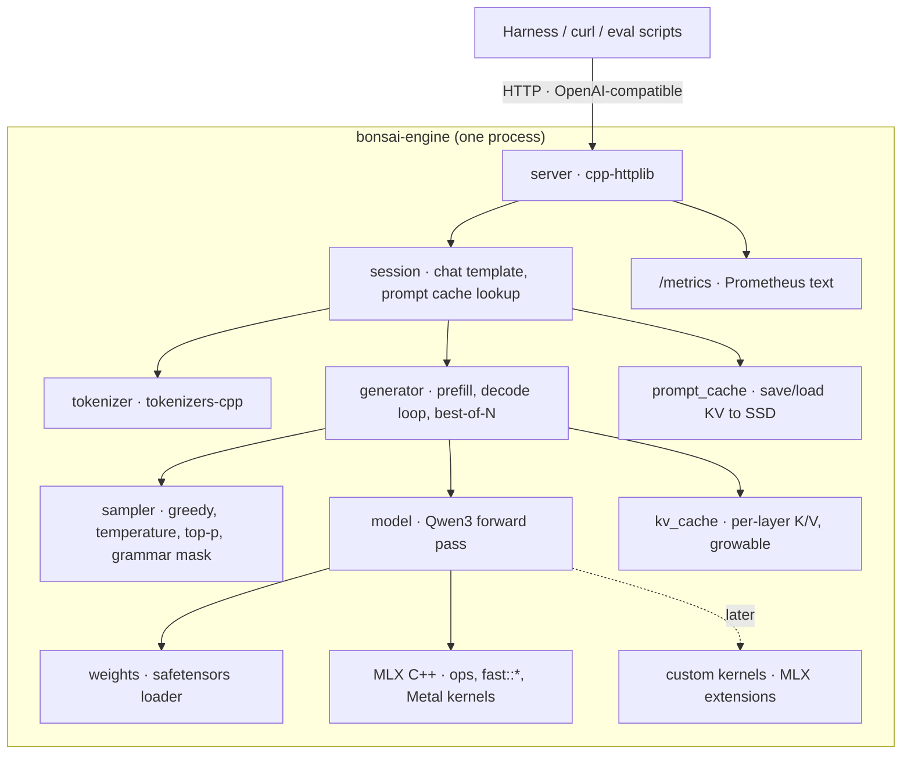

# bonsai-engine — a C++ inference engine for Ternary Bonsai 8B on Apple Silicon

A single-model, single-user LLM inference engine written in C++ on top of MLX's C++ API, targeting a base M4 Mac mini (16 GB). It serves [`prism-ml/Ternary-Bonsai-8B-mlx-2bit`](https://huggingface.co/prism-ml/Ternary-Bonsai-8B-mlx-2bit) over an OpenAI-compatible HTTP endpoint, and acts as the lab for custom Metal kernels.

This is the **build plan** for the inference engine described in the research catalog ([../README.md](../README.md)). The catalog lists every option considered; this document records what was chosen and the order to build it in.

**Status:** not started. Nothing below exists yet except this document.

---

## Contents

1. [Goals and non-goals](#1-goals-and-non-goals)
2. [Decisions](#2-decisions)
3. [The model](#3-the-model)
4. [The performance model](#4-the-performance-model)
5. [Architecture](#5-architecture)
6. [Repository layout](#6-repository-layout)
7. [Toolchain and environment](#7-toolchain-and-environment)
8. [Testing strategy](#8-testing-strategy)
9. [Build plan, milestone by milestone](#9-build-plan-milestone-by-milestone)
10. [Experiments](#10-experiments)
11. [Benchmark protocol](#11-benchmark-protocol)
12. [Study guide](#12-study-guide)
13. [Risks and open questions](#13-risks-and-open-questions)

---

## 1. Goals and non-goals

### Goals

1. **Learn C++ by building something real.** Most of the engine is C++. Python is used only where it is clearly the better tool: generating reference outputs, benchmark orchestration, and evals.
2. **Run Bonsai 8B at or above `mlx-lm`'s speed** on the M4 mini, with token-identical greedy output.
3. **Make the techniques that matter at N=1 first-class:** a prompt cache saved to disk, batched best-of-N, and later custom kernels.
4. **Expose an OpenAI-compatible API** so the agent harness, eval tools and any client can use it, and so it can be swapped against `mlx-lm`'s server for comparison.
5. **Be measurable from day one.** Every change is gated on correctness, then measured against a logged baseline.

### Non-goals (for now)

| Not doing | Why |
|---|---|
| Supporting other models | One model means hardcoding shapes is a feature. Generality is how a general framework loses to a specialized one |
| Continuous batching, multi-user scheduling | One user. See catalog §9.1 |
| Writing every kernel from scratch in raw Metal | Months before the first token. MLX's kernels do the heavy math; custom kernels come later, one at a time, where they beat MLX |
| Training or fine-tuning | Out of scope for the engine |
| The agent harness | A separate process that talks to this engine over HTTP (catalog §2.3) |

---

## 2. Decisions

| Decision | Choice | Alternatives considered | Reasoning |
|---|---|---|---|
| Model | **Ternary Bonsai 8B, MLX 2-bit** | Qwen3-8B Q4_K_M | 2.3 GB vs ~4.7 GB. That roughly doubles the decode ceiling and frees ~2.4 GB for KV cache or batched candidates. Accepted cost: BFCL 73.9 vs 81.0 on the vendor's numbers. Best-of-N and constrained decoding are the planned ways to close that gap |
| Runtime base | **MLX C++ API** (`mlx/mlx.h`) | llama.cpp, raw Metal (metal-cpp), Python `mlx-lm` | Bonsai ships only in MLX format, so llama.cpp is out for now. Raw Metal means writing every kernel before the first token. Python `mlx-lm` works but teaches no C++. MLX C++ gives tuned kernels for free and leaves the whole engine to write |
| Language | **C++20** for the engine; Python for references, benchmarks and evals | All-Python; all-C++ | The engine is where the learning is. Reference generation and stats are easier in Python, and `mlx-lm` already exists as a ground truth |
| Build system | **CMake** | Bazel, Meson | MLX ships CMake config files; it's what every dependency here supports |
| Unit tests | **Catch2 v3** via `FetchContent` | GoogleTest | Lighter setup, readable assertions. Either is fine |
| HTTP | **cpp-httplib** + **nlohmann/json** | Boost.Beast, Crow | Header-only, minimal. One user does not need an async server |
| Tokenizer | Token IDs passed in from Python until M6, then **tokenizers-cpp** | Writing a BPE tokenizer | Postpones a whole sub-project until the numerics are proven |

**What we lose by leaving llama.cpp**, and what replaces it:

| llama.cpp feature | Replacement here |
|---|---|
| `/metrics` Prometheus endpoint | Written in-house (M9). Counters for prompt tokens, generated tokens, prefill and decode seconds, KV cache use |
| GBNF / JSON-schema constrained decoding | A tool-call parser with retry in the harness first; later, grammar-constrained sampling in the engine (M12) |
| Battle-tested server | Ours is smaller and less robust. The harness must survive engine restarts (catalog §2.3) |

---

## 3. The model

### 3.1 Facts from the model card

| Item | Value |
|---|---|
| Base model | Qwen3-8B |
| Parameters | 8.19B (~6.95B non-embedding) |
| Layers | 36 decoder blocks |
| Attention | GQA: 32 query heads, 8 KV heads, head dim 128 |
| MLP | SwiGLU |
| Positional encoding | RoPE |
| Norm | RMSNorm |
| Context | 65,536 tokens |
| Vocab | 151,936 |
| Weights | Ternary {−1, 0, +1}, one FP16 scale per group of 128 |
| Storage | MLX 2-bit format, ~2.125 bits/weight, 2.3 GB total |
| Ternary coverage | Embeddings, attention projections, MLP projections, LM head |

### 3.2 Facts to verify in M2 (from Qwen3-8B, not stated on the card)

Read these from `config.json` and the safetensors header instead of trusting this table:

| Item | Expected | Why it matters |
|---|---|---|
| `hidden_size` | 4096 | Every matmul shape |
| `intermediate_size` | 12288 | MLP shapes |
| `rope_theta` | 1,000,000 | RoPE base |
| `rms_norm_eps` | 1e-6 | RMSNorm epsilon |
| `tie_word_embeddings` | false (separate `lm_head`) | Whether the output projection reuses the embedding |
| QK-norm | `q_norm` and `k_norm` per layer | **Qwen3-specific:** an RMSNorm over each head's 128 dims, applied to Q and K *before* RoPE. Easy to miss when porting |
| `quantization` | `{"group_size": 128, "bits": 2}` | Arguments to `quantized_matmul` / `dequantize` |
| Scales and biases | Probably standard MLX affine quantization (`.scales` and `.biases` tensors). Ternary maps onto 2-bit as `q ∈ {0,1,2}`, `w = scale·q + bias` with `bias = −scale` | Decides whether MLX's built-in quantized ops work as-is (the card says they do) |

### 3.3 Expected tensor names

Following `mlx-lm`'s Qwen3 implementation (confirm in M2):

```
model.embed_tokens.{weight,scales,biases}
model.layers.{0..35}.input_layernorm.weight
model.layers.{i}.self_attn.{q_proj,k_proj,v_proj,o_proj}.{weight,scales,biases}
model.layers.{i}.self_attn.{q_norm,k_norm}.weight
model.layers.{i}.post_attention_layernorm.weight
model.layers.{i}.mlp.{gate_proj,up_proj,down_proj}.{weight,scales,biases}
model.norm.weight
lm_head.{weight,scales,biases}
```

### 3.4 The forward pass in one place

```
x      = dequantize(embed_tokens[ids])                     # [B, L, 4096]

for each of 36 layers:
    h  = rms_norm(x, input_layernorm)
    q  = qlinear(h, q_proj) → [B, L, 32, 128] → rms_norm(·, q_norm) → transpose → rope(offset)
    k  = qlinear(h, k_proj) → [B, L,  8, 128] → rms_norm(·, k_norm) → transpose → rope(offset)
    v  = qlinear(h, v_proj) → [B, L,  8, 128]                       → transpose
    k, v = kv_cache.update(k, v)                            # append, return full history
    a  = sdpa(q, k, v, scale = 1/√128, mask = causal)      # GQA handled by sdpa
    x  = x + qlinear(a → [B, L, 4096], o_proj)

    h  = rms_norm(x, post_attention_layernorm)
    x  = x + qlinear( silu(qlinear(h, gate_proj)) * qlinear(h, up_proj), down_proj )

logits = qlinear(rms_norm(x, model.norm), lm_head)          # [B, L, 151936]
```

Every operation here exists in MLX: `fast::rms_norm`, `fast::rope`, `fast::scaled_dot_product_attention`, `quantized_matmul`, `dequantize`, `take`. **Writing the engine means composing these correctly, managing state (the KV cache), and controlling evaluation.** That is where both the C++ and the performance work live.

---

## 4. The performance model

### 4.1 The decode ceiling

Decode reads every weight once per token, and the M4 is far below its compute limit while doing it. So:

```
max tok/s  ≈  memory bandwidth  ÷  bytes read per token
bytes/token ≈  weights read  +  KV cache read
```

| Quantity | Value |
|---|---|
| Bandwidth (published) | ~120 GB/s. Replace with the measured value from M3 |
| Weights read per token | ~2.13 GB: 2.3 GB minus the embedding table, of which only one row is read per token |
| KV cache per token of context | 36 layers × 8 heads × 128 dims × 2 (K and V) × 2 bytes = **147 KB** (fp16) |
| KV read per step at 8K context | ~1.2 GB |
| KV read per step at 32K context | ~4.8 GB, over 2× the weights |

| Context | Bytes per step | Ceiling |
|---|---|---|
| Short (~0) | 2.13 GB | **~56 tok/s** |
| 8K | 3.3 GB | ~36 tok/s |
| 32K | 7.0 GB | ~17 tok/s |

**Calibration:** the model card reports 83 tok/s on an M4 Pro (273 GB/s). That's about 65–70% of its ceiling. At the same efficiency, expect **~36–38 tok/s on the mini at short context**. Treat that as the baseline to reach in M7.

**Consequence:** past ~8K tokens the KV cache dominates. KV cache quantization (8-bit halves it) is a speed lever as well as a memory lever.

### 4.2 Arithmetic intensity

| | FLOPs per byte |
|---|---|
| M4 GPU ridge point (~4 TFLOPS ÷ 120 GB/s) | ~35 |
| Decode (one token, 2 FLOPs per weight, ~0.27 bytes per weight) | ~7.5 |
| Prefill of L tokens | ~7.5 × L |

Decode is memory-bound by a factor of ~5. Prefill becomes compute-bound at around 5–10 tokens per batch.

**This is why batched best-of-N is nearly free:** decoding 5 sequences at once reads the weights once and does 5× the math, and there is spare compute for exactly that. It is the same reason speculative decoding works.

### 4.3 The third regime: overhead

At ~25 ms per token, the CPU has to build and dispatch hundreds of GPU kernels per token (36 layers × ~15 ops). If that takes a few milliseconds, it's 10%+ of the budget. This is where a C++ engine can beat Python `mlx-lm` without any new kernels. It is also why the M7 benchmark compares against `mlx-lm` and not only against the bandwidth ceiling.

---

## 5. Architecture



### Components

| Component | Responsibility | Key types |
|---|---|---|
| `weights` | Load safetensors, parse `config.json`, check every expected tensor exists with the expected shape | `ModelConfig`, `Weights` (name → `mx::array`), `QuantLinear` |
| `model` | The forward pass in §3.4. Stateless apart from weights; the cache is passed in | `Qwen3Model::forward(ids, cache) → logits` |
| `kv_cache` | Per-layer K/V storage. Grows in fixed steps, tracks offset, can be cloned for best-of-N | `KVCache`, `LayerCache` |
| `sampler` | Logits → token. Greedy first, then temperature and top-p, then grammar masking | `Sampler`, `SamplingParams` |
| `generator` | Prefill, then a decode loop with lookahead evaluation. Batched decode for N candidates | `Generator`, `GenerationResult` |
| `prompt_cache` | Hash a token prefix, save or load its KV state as safetensors on SSD | `PromptCache` |
| `tokenizer` | Text ↔ IDs, special tokens, Qwen3 chat template | `Tokenizer`, `ChatTemplate` |
| `server` | `/v1/chat/completions` (streaming over SSE), `/health`, `/metrics` | `Server` |
| `metrics` | Counters and timers, Prometheus text output | `Metrics` |

### Design rules

1. **The model is a pure function of (weights, ids, cache).** No hidden state. That makes it testable piece by piece.
2. **Shapes are known constants.** Put them in `ModelConfig`, check them at load time, and fail loudly on a mismatch. We are not building a general framework.
3. **Evaluation is explicit.** MLX is lazy: nothing runs until `eval`. Decide where evaluation happens (once per token in decode, with the next step queued via `async_eval`), and never trigger it by accident (printing an array, calling `.item()`) inside the hot loop.
4. **One process, one model, always warm.** Load once at startup.

---

## 6. Repository layout

```
apple_accel/
├── README.md                     # research catalog (existing)
├── engine/                       # ← this project
│   ├── README.md                 # this file
│   ├── CMakeLists.txt
│   ├── CMakePresets.json         # "linux-cpu-debug", "macos-metal-release"
│   ├── include/bonsai/
│   │   ├── config.hpp
│   │   ├── weights.hpp
│   │   ├── model.hpp
│   │   ├── kv_cache.hpp
│   │   ├── sampler.hpp
│   │   ├── generator.hpp
│   │   ├── prompt_cache.hpp
│   │   ├── tokenizer.hpp
│   │   ├── server.hpp
│   │   └── metrics.hpp
│   ├── src/                      # one .cpp per header
│   ├── apps/
│   │   ├── hello_mlx.cpp         # M1
│   │   ├── inspect.cpp           # M2: print tensors and config
│   │   ├── generate.cpp          # M6: command-line generation
│   │   └── serve.cpp             # M9: HTTP server
│   ├── kernels/                  # M10+: custom Metal kernels and MLX extensions
│   └── tests/
│       ├── test_config.cpp
│       ├── test_layers.cpp       # compare against reference tensors
│       ├── test_generate.cpp     # golden token sequences
│       └── reference/            # generated, gitignored (see §8.2)
├── scripts/
│   └── ref/
│       ├── dump_reference.py     # mlx-lm → intermediate tensors (.safetensors)
│       └── dump_golden.py        # mlx-lm → golden greedy token IDs (.json)
├── bench/
│   ├── bandwidth.py              # measured memory-bandwidth ceiling
│   ├── decode.py                 # tok/s, TTFT, CoV against any OpenAI endpoint
│   └── results/                  # JSON per run, committed
└── evals/
    └── tools/                    # tool-calling task set and scorer
```

**Why `bench/` and `evals/` talk HTTP:** the same scripts can point at `mlx_lm.server` (the reference) and at `bonsai-engine serve`. Comparing the two is one URL change.

---

## 7. Toolchain and environment

### 7.1 Two machines, two roles

| | WSL (dev box) | Mac mini M4 |
|---|---|---|
| MLX backend | CPU | Metal |
| Engine compiles and runs | ✅ slowly | ✅ |
| Unit and correctness tests | ✅ | ✅ |
| Custom Metal kernels | ❌ | ✅ |
| Benchmarks | ❌ never | ✅ only here |

MLX builds on Linux with a CPU backend, so **all of M1–M6 can be developed and tested in WSL.** The mini is needed for speed and for Metal-specific work. Numbers produced on WSL are not benchmarks.

**Workflow options** (pick one):
- **VS Code Remote-SSH into the mini over Tailscale.** Edit and build there directly. Simplest.
- **Develop in WSL, `git push`, then `git pull && cmake --build` on the mini.** Better when working offline from the mini.

### 7.2 Pin versions

MLX's C++ API is less documented than Python's and changes between releases. **Use the same MLX version** for the C++ engine, the Python reference scripts, and both machines. Record it in every benchmark JSON.

### 7.3 Getting MLX for C++

Two routes; verify against the MLX docs for the pinned version:

**A. From the pip package** (headers and `libmlx` ship in the wheel):
```bash
pip install "mlx==<pinned>"              # macOS
pip install "mlx[cpu]==<pinned>"         # Linux / WSL
cmake -B build -DMLX_DIR="$(python -m mlx --cmake-dir)"
```

**B. From source:**
```bash
git clone https://github.com/ml-explore/mlx && cd mlx && git checkout v<pinned>
cmake -B build -DMLX_BUILD_TESTS=OFF -DMLX_BUILD_EXAMPLES=OFF \
      -DMLX_BUILD_METAL=OFF          # Linux only; omit on macOS
cmake --build build -j && cmake --install build --prefix ~/.local
```

Then in `engine/CMakeLists.txt`:
```cmake
cmake_minimum_required(VERSION 3.24)
project(bonsai_engine LANGUAGES CXX)
set(CMAKE_CXX_STANDARD 20)
set(CMAKE_CXX_STANDARD_REQUIRED ON)

find_package(MLX CONFIG REQUIRED)

add_library(bonsai src/config.cpp src/weights.cpp)   # grows per milestone
target_include_directories(bonsai PUBLIC include)
target_link_libraries(bonsai PUBLIC mlx)

add_executable(hello_mlx apps/hello_mlx.cpp)
target_link_libraries(hello_mlx PRIVATE bonsai)
```

### 7.4 Python side

One virtual environment (`uv` or `venv`) at the repo root, with `mlx`, `mlx-lm`, `numpy`, `pytest`, `requests`. `mlx-lm` is the **reference implementation**: it already runs Bonsai, and it is the ground truth until our engine matches it.

### 7.5 Compiler hygiene

Turn these on from the first commit; they're much harder to add later:
- `-Wall -Wextra -Wpedantic -Werror` on our targets (not on dependencies)
- An AddressSanitizer + UndefinedBehaviorSanitizer build preset for WSL (`-fsanitize=address,undefined`)
- `clang-format` with a checked-in `.clang-format`
- `clang-tidy` with a small rule set (`bugprone-*`, `performance-*`, `modernize-*`)

---

## 8. Testing strategy

### 8.1 Three layers

| Layer | Where | What | Speed | When |
|---|---|---|---|---|
| **1. Unit** | WSL and mini | Config parsing, shape checks, sampler logic, cache bookkeeping, JSON, chat template. No model weights needed | Seconds | Every build |
| **2. Correctness** | WSL and mini | Intermediate tensors and greedy tokens compared against `mlx-lm` references | Seconds to minutes | Every change to the model, cache, or kernels |
| **3. Performance** | Mini only | §11 protocol | Minutes | Only after layer 2 passes |

**The rule: correctness gate before performance gate.** A faster wrong answer is not progress.

### 8.2 Reference tensors

`scripts/ref/dump_reference.py` runs `mlx-lm` on a fixed short prompt (~16 tokens) and saves intermediate values as safetensors:

| Key | Shape | Used in |
|---|---|---|
| `input_ids` | [1, 16] | All |
| `embed_out` | [1, 16, 4096] | M3 |
| `layer0_attn_norm` | [1, 16, 4096] | M3 |
| `layer0_out` | [1, 16, 4096] | M4 |
| `layer35_out` | [1, 16, 4096] | M5 |
| `logits_last` | [1, 151936] | M5 |

Sketch of the dump script (check the API against your installed `mlx-lm` version; internals move between releases):

```python
import mlx.core as mx
from mlx_lm import load
from mlx_lm.models.base import create_attention_mask

model, tok = load("prism-ml/Ternary-Bonsai-8B-mlx-2bit")
ids = mx.array([tok.encode("The quick brown fox jumps over the lazy dog. In summary,")])

inner = model.model
out = {"input_ids": ids}
h = inner.embed_tokens(ids);                         out["embed_out"] = h
mask = create_attention_mask(h, None)
out["layer0_attn_norm"] = inner.layers[0].input_layernorm(h)
for i, layer in enumerate(inner.layers):
    h = layer(h, mask, None)
    if i in (0, 35): out[f"layer{i}_out"] = h
out["logits_last"] = model.lm_head(inner.norm(h))[:, -1, :]

mx.save_safetensors(f"engine/tests/reference/ref_{mx.default_device()}.safetensors", out)
```

**Generate references per backend.** CPU and Metal produce slightly different floating-point results. Compare WSL-built engine output against a CPU-generated reference, and mini output against a Metal-generated reference. Reference files are gitignored; the script is the source of truth.

**Tolerances.** Activations are fp16 or bf16, so exact equality is impossible for intermediates. Start at `rtol = 1e-2, atol = 1e-2` on activations, and track the **max absolute difference** in test output so you notice drift before it crosses the threshold. Logits: compare argmax exactly, and top-10 by set overlap.

### 8.3 Golden tokens

`scripts/ref/dump_golden.py` runs greedy decoding (temperature 0) for 10 fixed prompts × 64 tokens and saves the token IDs as JSON. The engine must reproduce them **exactly**.

If a later change produces a different token at some position, that's a correctness regression until proven otherwise. The only accepted exception is a near-tie: the top-2 logits within ~1e-3 of each other at the diverging position. The test reports this case instead of failing silently.

### 8.4 C++ test sketch

```cpp
#include <catch2/catch_test_macros.hpp>
#include <mlx/mlx.h>
#include "bonsai/model.hpp"
namespace mx = mlx::core;

TEST_CASE("layer 0 matches mlx-lm") {
    auto [ref, meta] = mx::load_safetensors(reference_path());
    auto model = bonsai::Qwen3Model::load(model_dir());

    auto h   = model.embed(ref.at("input_ids"));
    auto out = model.layer(0, h, /*cache=*/nullptr);
    mx::eval(out);

    auto diff = mx::max(mx::abs(out - ref.at("layer0_out"))).item<float>();
    INFO("max abs diff = " << diff);
    REQUIRE(mx::allclose(out, ref.at("layer0_out"), 1e-2, 1e-2).item<bool>());
}
```

---

## 9. Build plan, milestone by milestone

Every milestone ends with a passing test and a commit. **Done when** is the exit criterion. **C++ focus** is what that milestone teaches.

### Phase 1 — Numerics (WSL is enough)

#### M1 · Hello MLX
Set up the CMake project, link MLX, and write `apps/hello_mlx.cpp`, which creates two arrays, adds them, evaluates and prints. Add Catch2 and one trivial test. Add the CMake presets.
- **Done when:** it builds and runs on WSL (CPU) and on the mini (Metal), and `ctest` passes on both.
- **C++ focus:** CMake targets, `find_package`, `FetchContent`, compiler flags, the `mx::array` handle type (reference-counted; copying is cheap).

#### M2 · Weights and config
`ModelConfig::from_json(path)` (nlohmann/json) and `Weights::load(dir)`. Write `apps/inspect.cpp`, which prints every tensor name, shape and dtype, plus the quantization config.
- **Done when:** the output matches what Python prints for the same files, every row in §3.2 is confirmed or corrected in this README, and loading fails with a clear error if a tensor is missing or has the wrong shape.
- **C++ focus:** `std::filesystem`, `std::unordered_map`, structured bindings, exceptions vs `std::expected`, `const&` vs value semantics.

#### M3 · Embedding and RMSNorm
Write a `QuantLinear` wrapper (weight, scales, biases, group_size, bits) with `forward(x)` calling `mx::quantized_matmul`. Implement the quantized embedding lookup (`take` the rows of weight, scales and biases, then `dequantize`). Add RMSNorm via `mx::fast::rms_norm`.
- **Done when:** `embed_out` and `layer0_attn_norm` match the reference.
- **C++ focus:** small value types, constructors, `std::optional`, keeping header and implementation separate.

#### M4 · One decoder layer, no cache
Attention: Q/K/V projections, reshape and transpose, QK-norm, RoPE (offset 0), `fast::scaled_dot_product_attention` with a causal mask, output projection. MLP: gate, up, SiLU, multiply, down. Residual connections.
- **Done when:** `layer0_out` matches.
- **C++ focus:** reading shapes carefully. Most bugs here are a wrong transpose or reshape. Write a `check_shape(arr, {..})` helper and use it everywhere.
- **Common traps:** forgetting QK-norm; RoPE `traditional` flag (Qwen uses `false`); the SDPA scale; the GQA head layout.

#### M5 · Full forward pass
Run all 36 layers, the final norm, and the LM head.
- **Done when:** `layer35_out` and `logits_last` match, and the argmax matches exactly.
- **C++ focus:** iterating over layer weights cleanly (a `std::vector<LayerWeights>` built at load time, not string lookups in the hot path).

#### M6 · KV cache and greedy generation
`KVCache` with per-layer K/V buffers, grown in steps of 256 tokens with `slice_update` (the approach `mlx-lm` uses), with an offset passed to RoPE. Generation loop: prefill the prompt, then decode one token at a time. Write `apps/generate.cpp`, which takes token IDs on the command line. Then add tokenizers-cpp and the Qwen3 chat template (`<|im_start|>role\n…<|im_end|>`) so it takes text.
- **Done when:** all 10 golden sequences in §8.3 reproduce exactly.
- **C++ focus:** ownership and lifetimes (who owns the cache?), move semantics, preallocation, linking a Rust-backed library through CMake.

### Phase 2 — Speed (mini required)

#### M7 · Baseline benchmark and the overhead fight
Write `bench/bandwidth.py` (a measured GB/s ceiling) and `bench/decode.py` (§11). Benchmark `mlx_lm.generate` and our `generate` on the same prompts.
Then optimize the decode loop without touching kernels:
- `async_eval` lookahead, so token *t+1* is being built while token *t* is computed
- `mx::compile` around the per-token step
- no host-device syncs inside the loop
- `set_wired_limit` so the weights are never paged out
- **Done when:** tok/s ≥ `mlx-lm`, golden tokens still match, and results are logged as JSON with % of measured bandwidth.
- **Target:** ~36–38 tok/s at short context (§4.1).
- **C++ focus:** profiling (Instruments, Xcode GPU capture), `std::chrono`, avoiding accidental copies and allocations.

#### M8 · Prompt cache on disk
After prefilling a prompt, save each layer's K/V (sliced to the offset) plus metadata (`tokens_sha256`, `n_tokens`, `model_id`, `mlx_version`) with `mx::save_safetensors`. On a new request, find the longest cached prefix of its tokens, load that, and prefill only the rest.
- **Done when:** the TTFT experiment in §10.1 shows the drop, and generation from a loaded cache is token-identical to generation from scratch.
- **C++ focus:** hashing, file I/O, cache invalidation, RAII for temporary files (write to a temp file, then rename, so a crash never leaves a half-written cache).

#### M9 · HTTP server and metrics
`apps/serve.cpp`: `/v1/chat/completions` (streaming over SSE and non-streaming), `/health`, `/metrics`. One request at a time behind a mutex; reject or queue a second one. Prometheus text format for prompt tokens, generated tokens, prefill seconds, decode seconds, cache hits and misses, and KV tokens in use.
- **Done when:** `bench/decode.py` and the eval scripts run unchanged against both `mlx_lm.server` and ours, and Prometheus scrapes `/metrics`.
- **C++ focus:** threads, `std::mutex`, callbacks, streaming responses, graceful shutdown on SIGTERM (launchd sends it).

#### M10 · Batched best-of-N
Prefill once. Clone the cache N times along the batch axis (all candidates share the prefix, so no padding is needed). Decode a `[N, 1]` batch per step with independent sampling per row. Stop each row at EOS and drop finished rows from the batch.
- **Done when:** the experiment in §10.2 is complete.
- **C++ focus:** batch-dimension bookkeeping, per-row state, random number generation (`mx::random` keys per row for reproducibility).

### Phase 3 — Kernels (mini required)

#### M11 · First custom kernels
Start with `mx::fast::metal_kernel` from C++ (the C++ form of the Python prototyping API; check `mlx/fast.h` for the pinned version):
1. A copy kernel, to confirm the bandwidth measurement from inside the engine
2. A naive 2-bit quantized matvec, then iterate it toward `mx::quantized_matmul` (coalesced loads, SIMD-group reductions, vectorized unpacking)
3. **Fused gate/up + SiLU + multiply:** one kernel reading both weight matrices in one pass. MLX doesn't fuse across those op boundaries for us
- **Done when:** each kernel passes a reference comparison against the MLX ops it replaces, and has a benchmark row. Kernel 3 is kept only if it beats the unfused version end to end.
- **C++ / Metal focus:** Metal Shading Language, threadgroups and SIMD-groups (32 wide), threadgroup memory, `simd_sum`.

#### M12 · Pick one research track
| Track | Idea | Payoff |
|---|---|---|
| **Ternary packing** ⭐ | 3⁵ = 243 ≤ 256, so 5 ternary values fit in one byte: **1.6 bits** instead of 2. Repack the weights offline and write a matvec that decodes them on the fly | ~19% fewer bytes per token, so up to ~19% faster decode. A format no general framework will ship for one model |
| **KV cache quantization** | 8-bit K/V, with per-channel K and per-token V (KIVI) | Halves KV reads, which is the biggest cost past 8K context |
| **Grammar-constrained sampling** | Mask logits to valid JSON / tool-call syntax during decoding | Tool calls always parse. Directly attacks Bonsai's BFCL gap |
| **Prompt-lookup decoding** | Draft tokens by matching n-grams in the prompt (RAG answers copy retrieved text), verify them in one batch | Large speedups on retrieval-heavy answers, with no draft model |

For ternary packing, the order is: NumPy reference packer and unpacker (unit-tested on WSL) → offline repacking tool → Metal matvec matched against the reference → end-to-end golden tokens → benchmark.

Once a kernel earns its place, move it from `fast::metal_kernel` to a proper **MLX C++ extension** (a custom `Primitive` with `eval_cpu` / `eval_gpu` and a `.metal` file), so it works with `mx::compile` and has a CPU fallback for WSL tests.

---

## 10. Experiments

Each experiment changes one variable, holds everything else fixed, and logs its config.

### 10.1 Prompt cache TTFT

| | |
|---|---|
| Question | How much TTFT does a saved system-prompt cache save? |
| Setup | Fixed ~2K-token system prompt plus tool definitions, 20 different short user messages |
| Arms | No cache · cache in memory · cache loaded from SSD |
| Metrics | TTFT p50/p90, load time from disk, golden-token match |
| Expected | Run 1 pays full prefill; later runs pay roughly load time plus the new tokens only |

### 10.2 Best-of-N for tool calling

| | |
|---|---|
| Question | Can best-of-N close Bonsai's tool-calling gap? |
| Setup | `evals/tools/` task set (20–30 tasks, each with expected tool and arguments) |
| Arms | N = 1, 3, 5. Selection by "first candidate that parses and validates against the tool schema", then by majority vote over identical calls |
| Metrics | Task success rate, wall-clock time per task, total tok/s |
| Expected | Wall-clock time grows much less than N× (§4.2) |
| Comparison point | Qwen3-8B Q4 at N = 1 via `mlx-lm`. If Bonsai best-of-5 matches it, the model choice is confirmed |

### 10.3 Overhead budget (part of M7)

| | |
|---|---|
| Question | How much of each token's time is CPU-side graph building and dispatch? |
| Method | Instruments Metal System Trace: GPU busy time per token vs wall time per token |
| Decision | If the gap is over ~10%, `compile` and lookahead come before any kernel work |

---

## 11. Benchmark protocol

From catalog §10, reduced to what applies here:

1. **Machine state:** AC power, nothing else using the GPU, Spotlight and Syncthing paused, ≥30 s cooldown between heavy runs. Record thermal state via `powermetrics`.
2. **Warmup:** ≥10 iterations, discarded. The first runs include Metal shader compilation.
3. **Runs:** ≥5 measured, target 10. Report p50, p90, mean, std dev, **CoV**.
4. **CoV over 5% means the run is untrustworthy.** Find the cause before believing the number.
5. **Report % of measured bandwidth**, not just tok/s: `(bytes per token × tok/s) ÷ measured GB/s`.
6. **Log every run as JSON** in `bench/results/`: git SHA, MLX version, macOS version, prompt-set SHA-256, config, all raw samples, summary stats.
7. **Compare only within the same session** for small effects. Day-to-day drift is around 4%.
8. **One variable per comparison.**

Result file shape:

```json
{
  "timestamp": "2026-10-10T14:03:00Z",
  "git_sha": "abc1234",
  "engine": "bonsai-engine",
  "mlx_version": "x.y.z",
  "macos": "26.x",
  "model": "prism-ml/Ternary-Bonsai-8B-mlx-2bit",
  "prompt_set_sha256": "…",
  "config": {"max_tokens": 128, "context_tokens": 512, "batch": 1, "prompt_cache": false},
  "measured_bandwidth_gbps": 0.0,
  "samples": {"ttft_ms": [], "decode_tok_s": []},
  "summary": {"decode_tok_s_p50": 0.0, "cov": 0.0, "pct_of_bandwidth": 0.0}
}
```

---

## 12. Study guide

Concepts in the order this project needs them.

### Before M4
- **Transformer decoder internals:** attention, GQA, RoPE, RMSNorm, SwiGLU, residual stream. Read `mlx-lm`'s `models/qwen3.py` side by side with §3.4.
- **Lazy evaluation:** how MLX builds a graph and when it actually runs. The MLX docs' "lazy evaluation" page.
- **Affine quantization:** how `weight`, `scales` and `biases` combine for group-wise quantization in MLX.

### Before M7
- **Roofline model and arithmetic intensity** (§4). Horace He, *Making Deep Learning Go Brrrr From First Principles*: compute-bound, memory-bound, overhead-bound.
- **GEMV vs GEMM:** why decode and prefill behave differently.
- **Profiling on Apple GPUs:** Xcode GPU frame capture, Instruments Metal System Trace.

### Before M11
- **Metal execution model:** thread → SIMD-group (32) → threadgroup → grid. Threadgroup memory. `simd_sum`, `simd_shuffle`.
- **Memory access:** coalescing, vectorized loads, occupancy vs register pressure, latency hiding.
- **Fused dequantization:** unpack in registers inside the matvec, never write dequantized weights to memory.
- **Kernel fusion and tiling.**
- **Flash-Decoding:** splitting attention across the KV sequence at batch size 1.

### Reading list
| Source | For |
|---|---|
| MLX source: `mlx/ops.h`, `mlx/fast.h` | The C++ API you're programming against |
| MLX source: `backend/metal/kernels/quantized.h` (the `qmv` kernels) | The best textbook for M11; the kernels you're trying to match |
| `mlx-lm`: `models/qwen3.py`, `generate.py`, `models/cache.py` | Reference model, decode loop, and KV cache to port |
| `mlx-swift-examples` (Qwen3 in Swift) | A non-Python port of the same model; closer in shape to what you're writing |
| MLX docs: "Custom Extensions in MLX" | M12: moving a kernel to a proper `Primitive` |
| Apple: *Metal Shading Language Specification* | M11 reference |
| Kirk & Hwu, *Programming Massively Parallel Processors* | GPU fundamentals (CUDA, but the ideas carry over) |
| GPU MODE lectures | Kernel optimization walkthroughs |
| Hazy Research, *"Look Ma, No Bubbles"* (megakernels) | Where per-model specialization ends up |
| Ma et al., *BitNet b1.58*; Prism ML Bonsai white paper | Why ternary works, and how this model was made |

---

## 13. Risks and open questions

| Risk / question | Mitigation or plan |
|---|---|
| MLX C++ API changes between versions | Pin one version everywhere (§7.2). Upgrade deliberately, re-run golden tests |
| The pip wheel may not ship what CMake needs on Linux | Fall back to building MLX from source (§7.3 B) |
| CPU and Metal produce different numerics | Per-backend references (§8.2). Golden-token tests must pass on both |
| Bonsai's quantization may not be plain MLX affine | Confirmed or refuted in M2 by reading the tensors. If it's custom, M3 needs a custom dequantization, which moves kernel work earlier |
| Tool-calling quality is lower than Qwen3-8B (BFCL 73.9 vs 81.0) | Experiment 10.2, then grammar-constrained sampling (M12). The eval decides |
| Vendor benchmarks are self-reported | Our own eval set is the authority (catalog §2.4) |
| Only the MLX 2-bit format exists | Fine for this engine. Prism ML says other formats are coming; a GGUF would reopen llama.cpp as a comparison point |
| Scope creep | Phases are strictly ordered. No kernel work before M7 shows where the time goes |

Open questions to answer along the way:
1. What bandwidth does the mini actually reach? (M7)
2. How much of `mlx-lm`'s decode time is overhead rather than GPU work? (§10.3)
3. Does the 65K context work as advertised, and how far can it go before the KV cache forces a trade-off with best-of-N? (After M10)
4. Is the ternary packing win (~19%) real end to end, or eaten by the unpacking cost? (M12)
